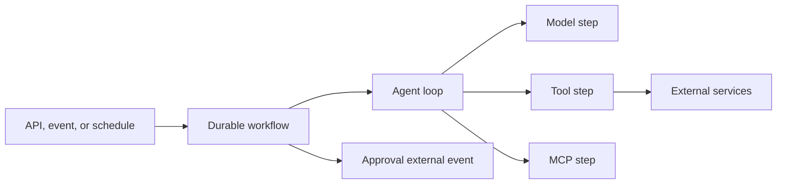

# 6. Reference architecture

This chapter shows you one way to lay out an agent project and how the runtime
pieces fit together. You do not have to copy the layout exactly, but you
should be able to point to where each part lives, because later chapters
assume these parts exist: the Agent Spec, the factory, workflows, durable
steps, evals, and the capability manifest.

## Repository structure

A consistent layout makes an agent reviewable: anyone can find its spec, its
tools, its evals, and its risk assessment without asking you.

```text
project/
├── .agents/
│   └── skills/                       # Skills for coding/development agents
├── <build manifest>                  # Dependency and packaging definition
├── src/<package>/
│   ├── agents/
│   │   └── <agent_name>/
│   │       ├── agent.yaml                # Declarative Agent Spec
│   │       ├── factory                   # Controlled assembly
│   │       ├── dependencies              # Typed runtime context
│   │       ├── types                     # Typed inputs and outputs
│   │       ├── instructions/
│   │       ├── skills/               # Private runtime skills
│   │       └── tools/                # Private tools
│   ├── skills/                       # Shared runtime skills
│   ├── tools/                        # Shared executable capabilities
│   │   ├── common/
│   │   └── <domain>/
│   ├── workflows/                    # Deterministic orchestration
│   ├── steps/                        # Durable steps that perform I/O
│   ├── runtime/
│   ├── observability/
│   ├── policy/
│   └── settings
├── evals/
│   ├── datasets/
│   ├── evaluators/
│   ├── experiments/
│   ├── fixtures/
│   └── baselines/
├── tests/
│   ├── unit/
│   ├── integration/
│   ├── workflow/
│   ├── replay/
│   └── security/
├── docs/
│   ├── risk-assessments/
│   ├── threat-models/
│   └── runbooks/
└── deploy/
```

Where things go:

- Keep agent-private skills and tools next to their agent.
- Move a capability to the shared directory only when several agents use it
  or it is a platform-wide concern.
- Shared directories MUST have explicit maintainers; they MUST NOT become
  unowned catalogs.
- Put runtime Agent Skills under `src/<package>/skills/` or the agent package.
- Reserve `.agents/skills/` for instructions to development and coding
  agents, not for skills your agent loads at runtime.

## Runtime architecture



Each part has one job:

- **The workflow** owns durable coordination. It is deterministic, so it can
  be replayed after a crash.
- **Durable steps** own nondeterministic work and I/O: model calls, tool
  calls, MCP calls, and anything else that touches the outside world.
- **The factory** assembles a validated configuration from approved models,
  skills, tools, policies, and runtime capabilities (see
  [factory responsibilities](07-agent-contract.md#factory-responsibilities)).

## Build and packaging

What you test should be what you ship. Agents fail in production when a spec
or skill file present on your machine is missing from the deployed artifact.

- Agent specifications, instruction files, and runtime `SKILL.md` files MUST
  be included as package data.
- Tests MUST load resources from the built package or equivalent deployment
  artifact.
- Runtime resource paths SHOULD be resolved relative to the installed package,
  not a process working-directory assumption.
- Production images SHOULD be immutable and run with a read-only application
  filesystem.

## Capability manifest

At startup, each agent produces its capability manifest: a bill of materials
for the running configuration. It is how you answer "what exactly was running
when this happened?" It contains:

```text
agent name and version
contract version
execution class, governance tier, and risk-assessment digest
resolved model and settings
instruction hashes
enabled skills, versions, and hashes
enabled toolsets and versions
output schema hash
budget policy
worker and build version
```

The manifest ID MUST appear in traces, audit records, and evaluation reports.
That one identifier lets you join a production incident to the evaluation run
that approved the same configuration.

## Common pitfalls

- **Testing from the source tree.** Tests pass locally but the deployed
  package lacks an instruction file. Load resources from the built artifact.
- **Doing I/O in the workflow.** A network call outside a durable step breaks
  replay and can repeat a side effect.
- **A shared tools folder nobody owns.** It grows into a catalog of
  unreviewed capabilities. Name maintainers, or keep the tool private.
- **Mixing coding-agent skills with runtime skills.** Instructions meant for
  your development tools end up loaded by the production agent.

## Before you move on

- [ ] You can point to the spec, factory, types, workflows, steps, evals, and
  risk assessment for your agent.
- [ ] All I/O happens in durable steps, not in workflow code.
- [ ] Tests load resources from the built artifact.
- [ ] The agent emits a capability manifest whose ID reaches traces, audit
  records, and eval reports.
