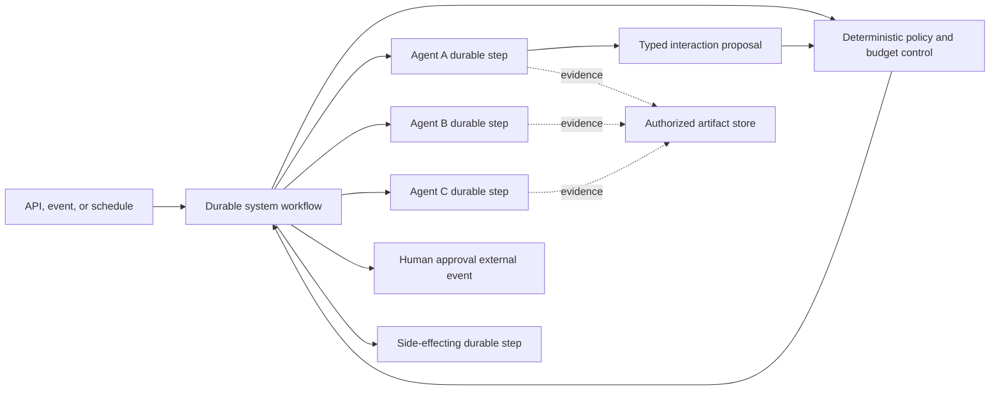

# 2. Reference architecture

This chapter shows how a multi-agent system is laid out and helps you pick
a topology. In short: choose the least dynamic shape that does the job, give
each kind of state one deterministic owner, and record exactly what you
shipped in a composition manifest.

## Repository structure

A system package sits alongside the agent packages it uses. Member agent
packages keep the
[structure the single-agent guidance requires](../core/06-reference-architecture.md#repository-structure);
the system adds composition contracts, coordination logic, policies, and
system-level evals.

```text
project/
├── agents/                             # Agent packages
│   └── <agent_name>/
│       └── agent spec
├── systems/
│   └── <system_name>/
│       ├── system spec
│       ├── factory/                    # builds the system from resolved specs
│       ├── contracts/                  # typed interaction and state contracts
│       ├── coordination/               # deterministic orchestration logic
│       └── policies/
│           ├── delegation policy
│           ├── data-flow policy
│           └── termination policy
├── workflows/
├── durable-steps/
├── runtime/
├── observability/
├── policy/
├── evals/
│   └── systems/<system_name>/
│       ├── datasets/
│       ├── evaluators/
│       ├── experiments/
│       ├── fixtures/
│       └── baselines/
├── tests/
│   ├── system/
│   ├── workflow/
│   ├── replay/
│   └── security/
├── docs/
│   ├── architecture-decisions/
│   ├── risk-assessments/
│   ├── threat-models/
│   └── runbooks/
└── deploy/
```

A system package references its members; it MUST NOT fork their prompts,
tools, or specs into composition-local copies.

## Runtime architecture



The workflow owns durable state and coordination. Deterministic policy
validates membership, edges, schemas, authority, data flow, budgets, approval,
and termination. Agent durable steps interpret, plan, investigate, review, and
synthesize within those boundaries. Large artifacts stay outside workflow
history and are passed by authorized reference.

## Choosing a topology

Move up this order only when evidence says you must:

```text
deterministic code
    before programmatic pipeline
        before model-selected supervisor/worker
            before dynamic membership or recursive topology
```

This is a burden-of-proof rule, not a maturity ranking. A dynamic architecture
is not better or worse in itself; it is justified when your evidence shows
that adaptability is necessary and its added failure modes are acceptably
controlled.

| Architecture | Best fit | Principal benefit | Principal cost or trade-off |
| --- | --- | --- | --- |
| Programmatic pipeline | Known stages and regulated processes | Predictable, testable control flow | Limited adaptation to unexpected work |
| Supervisor and worker | Ambiguous requests with stable specialists | Flexible routing with a small graph | Coordinator bottleneck and routing error |
| Fan-out and gather | Decomposable research or independent checks | Parallelism, coverage, and redundancy | Cost multiplication and result reconciliation |
| Producer and reviewer | Outputs with a useful review rubric | Separates generation from critique | Added latency and correlated reviewer failure |
| Handoff | Genuine transfer of responsibility | Clear specialization and lifecycle ownership | Context loss and ambiguous ownership at transfer |
| Quorum or voting | Independent judgments under uncertainty | Robustness when errors are genuinely diverse | Expensive; consensus can still be wrong |
| Hierarchical teams | Large systems with stable domains | Scales specialization and ownership | Compounded summaries, latency, and budgets |
| Shared blackboard | Iterative collaborative investigation | Flexible asynchronous contribution | State poisoning, contention, and convergence |
| Peer-to-peer mesh | Distributed local decisions | Avoids one work-plane bottleneck | Hard global governance and observability |
| Recursive task tree | Unknown decomposition and irregular tasks | Adaptive depth and parallel task discovery | Potentially exponential resource use |
| Dynamic membership | Variable expertise, locality, or capacity | Adaptability and extensibility | Supply-chain, compatibility, and reproducibility risk |
| Market or contract-net | Heterogeneous cost and capability | Adaptive resource allocation | Bid overhead, gaming, and selection complexity |
| Event-driven collective | Continuous asynchronous operations | Loose coupling and scalability | Delivery semantics and feedback-loop risk |

Topology is part of system behavior. Changing topology, routing authority,
aggregation, concurrency, or membership requires a system version change and
relevant evaluation and risk review.

## Topology profiles

### Programmatic pipeline

Deterministic code invokes members in a fixed order and maps typed outputs to
typed inputs. Use it as the default when the stages and transitions are
known. It has the smallest routing surface and is easiest to replay, test,
and explain.

### Supervisor and worker

A coordinator proposes which allowlisted specialist should handle a bounded
task, and deterministic policy validates the proposal before dispatch. Use it
when the right specialist depends on interpreted request content. The
coordinator MUST have finite choices, depth, fan-out, rounds, and budget.

### Bounded fan-out and gather

Several members work independently before deterministic aggregation or a
separate synthesis step. Use it when parallelism or independent evidence
materially improves latency, coverage, or confidence. The system MUST define
maximum concurrency, stable branch identities, merge ordering, duplicate
handling, and partial-failure behavior.

### Producer and reviewer

One member produces a result and another evaluates it against a typed rubric;
deterministic policy accepts, rejects, retries, or escalates. Agent review is
behavioral evidence. It MUST NOT grant authorization, approve a consequential
action, accept residual risk, or replace required human review.

### Handoff

Control transfers from one member to another and does not automatically
return. Use it when responsibility genuinely changes. The handoff MUST
transfer a typed state summary, evidence references, remaining budget,
deadline, authorization context, and explicit ownership of the next outcome.

### Quorum or voting

Multiple members produce judgments that a documented aggregation rule
combines. Use it only when evaluation shows that the chosen independence and
aggregation method improve the target outcome. Agreement is not evidence of
truth, and correlated models or prompts MUST NOT be represented as
independent votes.

### Hierarchical teams

A root coordinator delegates to domain coordinators, which manage bounded
specialist groups. Use it for large tasks with stable domain boundaries,
separate owners, or different security and operational zones. Hierarchy
shrinks the root's context and routing surface, but adds handoff loss,
compounded latency, nested budgets, and the risk that summaries hide
important evidence or dissent.

### Shared blackboard

Members coordinate through governed shared state holding tasks, claims,
evidence, and status, rather than only through direct calls. Use it for
iterative investigation, planning, and engineering work where contributors
build on partial results. Expect contention, stale state, poisoning,
provenance, consistency, retention, and termination problems. The blackboard
MUST have typed records, controlled writers, provenance, conflict rules, and a
deterministic state owner.

### Peer-to-peer mesh

Members communicate directly across several allowed edges, without one
coordinator selecting every interaction. Use it when responsibilities are
genuinely distributed, local decisions are valuable, or the system must keep
working when a coordinator is unavailable. Global state, authorization,
observability, convergence, and incident containment all get harder.
Production meshes SHOULD keep a deterministic control plane even when their
work plane is decentralized.

### Recursive task tree

A member may decompose work and delegate bounded subtasks, whose members may
do the same until a terminal condition is reached. Use it when the task
structure is not known in advance and decomposition quality is part of the
capability, such as broad research, migration analysis, or large repository
work. Trees can multiply cost, latency, duplicated work, inconsistent
assumptions, and cancellation complexity. They require strict depth, fan-out,
node, time, token, and spend limits plus no-progress detection.

### Dynamic membership

The system selects or admits members during a run from a governed registry,
based on capability, jurisdiction, data residency, availability, price,
latency, model diversity, or current state. Use it when the expertise or
capacity needed cannot be predicted, when independent teams supply
capabilities, or when graceful substitution is a product requirement. It
widens the authorization, compatibility, supply-chain, reproducibility, and
evaluation surface. Discovery alone is never admission (see
[chapter 4](04-membership-and-roles.md)).

### Market or contract-net allocation

Candidate members publish typed offers or bids for bounded tasks, and
deterministic policy selects one using declared criteria. Use it when agents
differ materially in capability, price, latency, locality, or availability.
Bidding adds overhead, strategic or misleading claims, nondeterminism, and
fairness concerns. Bid claims MUST be validated against registry metadata and
measured performance; agents cannot bid for authority outside their admitted
ceiling.

### Event-driven collective

Members react to typed events or state transitions and may emit further
events within an allowlisted protocol. Use it for monitoring, operations, and
long-running systems whose work arrives asynchronously. It must handle
duplicate, delayed, missing, and reordered messages, eventual consistency,
feedback loops, and difficult causal reconstruction.

### Combining profiles

Profiles combine. A deterministic workflow may start a bounded fan-out whose
branches use producer/reviewer pairs, or a hierarchy may pick one specialist
dynamically within each domain. The System Spec MUST describe the combined
topology and calculate limits across the whole composition rather than
treating each profile in isolation.

## Static and dynamic systems

Static and dynamic are a spectrum, not a binary:

| Dimension | More static | More dynamic |
| --- | --- | --- |
| Membership | Pinned before deployment | Selected or admitted during a run |
| Routing | Deterministic transitions | Model-, policy-, or market-selected edges |
| Topology | Fixed directed graph | Run-specific graph assembled from allowed rules |
| Decomposition | Predefined stages | Recursive task discovery |
| State | Workflow-local typed state | Shared or event-driven collaborative state |
| Lifetime | Bounded request or workflow | Persistent collective with changing participants |

Dynamic behavior is appropriate when its adaptability, resilience,
parallelism, or reach produces a measured benefit that exceeds its added
quality, security, operational, latency, and cost burden. It is inappropriate
when a simpler topology achieves the same result without losing a material
product or control objective.

A dynamic system MUST still have a static control envelope: trusted
registries, admission rules, maximum authority, permitted protocols, data
boundaries, resource ceilings, terminal conditions, audit requirements, and
kill switches are established before the run.

## State ownership

The System Spec identifies one authority for each category of state:

| State | Required owner |
| --- | --- |
| Workflow status, branch status, and termination | Durable workflow |
| Authorization and approval | Deterministic policy and authenticated identity |
| Budget reservations and consumption | Shared budget service or workflow-backed ledger |
| Large evidence and artifacts | Authorized external store |
| Agent-local message history | That agent run only |
| Accepted facts and final decision | Declared deterministic system component |

Shared mutable transcripts SHOULD NOT be the canonical system state. If you
use shared memory, its writer policy, reader policy, schema, provenance,
conflict model, retention, deletion, and poisoning controls MUST be explicit.

## Workflow decomposition

Start with one top-level workflow when the coordination history is bounded.
Use child workflows only when a branch needs an independent durable
lifecycle, separate worker ownership, an independent cancellation policy, or
history scaling. Code organization alone is not a reason.

Every branch and interaction has a stable ID. Concurrent results are
reconciled with deterministic ordering and conflict policy. Cancellation,
compensation, and final outcome semantics cover the entire delegation tree.

## Composition manifest

Each member produces its own
[capability manifest](../core/06-reference-architecture.md). The
composition manifest is the system-level equivalent. At startup or build
time, resolve the System Spec into an immutable composition manifest
containing:

```text
system name, version, contract version, and spec digest
owner, execution class, governance tier, and risk-assessment digest
topology and policy versions
member roles, Agent Spec versions, and capability manifest IDs
allowed interaction edges and input/output schema hashes
resolved system, member, and interaction budgets
workflow, worker, and build versions
evaluation policy and approved baseline
```

The manifest ID MUST appear in traces, audit records, evaluation reports,
approval records, deployment records, and incident references.

## Ownership rules

Member owners remain accountable for their agent contracts, as the Agent
Playbook's [ownership](../core/12-production-readiness.md#ownership)
rules require. The system adds:

- One accountable product owner and one operational owner for the system.
- An owning team for every role and interaction edge.
- System owners accountable for integration behavior and composition risk.
- Explicit maintainers for shared policies and registries.
- No member, edge, policy, or shared state store admitted without an owner.

## Common pitfalls

- **Starting dynamic.** A mesh or recursive tree was chosen up front, and a
  pipeline would have met the need with a fraction of the evidence burden.
- **Limits per profile, not per system.** Each fan-out had a cap, but nested
  together they could multiply past any budget.
- **A transcript as the source of truth.** Agents read and wrote one shared
  history, and nobody could say which facts had been accepted.

## Before you move on

- [ ] We chose the least dynamic topology that meets the need and recorded
  why.
- [ ] Limits are calculated across the combined topology.
- [ ] Each state category has one named owner.
- [ ] The composition manifest ID reaches traces, audit, evals, and approvals.
