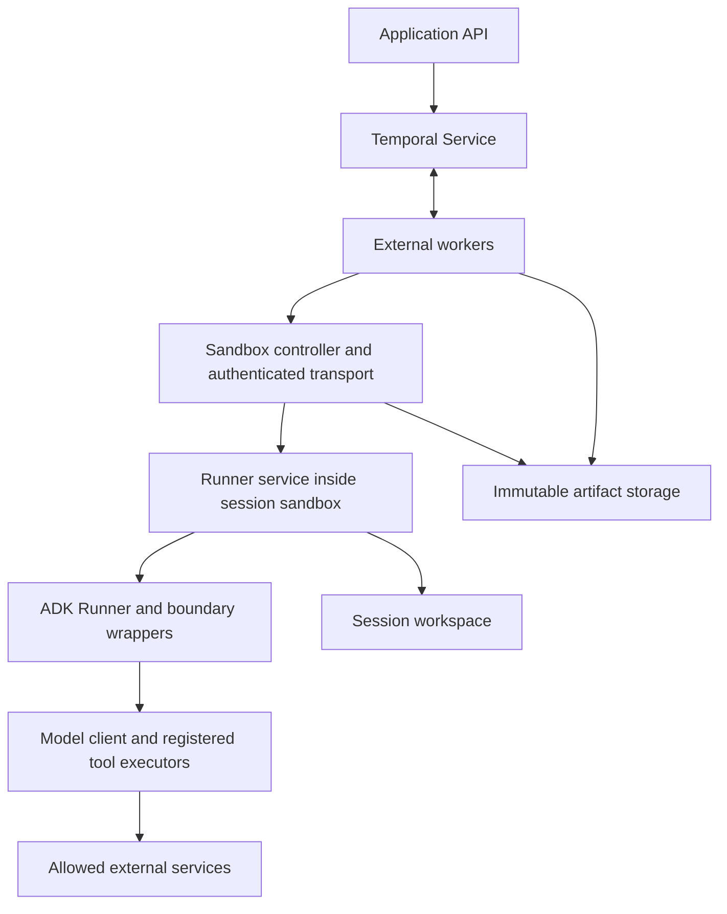
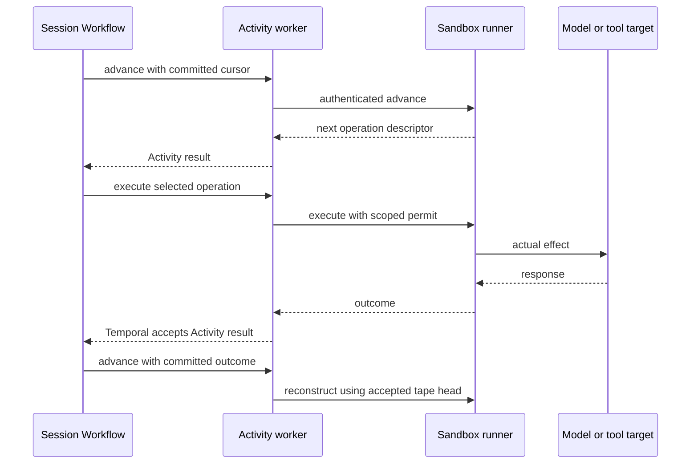

# Draft specification for a Temporal bridge to Google ADK in OpenShell

Draft for architecture review. Version 0.2. Independently reviewed and revised 17 October 2026.

The proposed bridge contains the complete Google ADK runtime and its tools inside one OpenShell sandbox per session, while external Temporal workers own scheduling, accepted results, approvals, and lifecycle. Temporal is the only progress and decision authority; immutable artifact storage retains the bytes referenced by its history. Version 1 supports a restricted durable feature profile, not every feature of ADK.

The initial implementation supports a bounded, serial `LlmAgent` profile. Each advance reconstructs the invocation from a fixed base and committed outcomes, captures the next boundary, and discards that local execution. A separate execute request runs the approved operation from its canonical descriptor. This avoids a persistent parked Python task and executable closures across RPCs. The guarantees assume the approved adapter follows this protocol; sandbox containment remains the security boundary against hostile tools, which can interfere with their same-domain runner.

All protocol names, bridge classes, configuration fields, and code snippets below are proposed unless explicitly identified as existing APIs. Snippets illustrate contracts and control flow; they are not a tested implementation. Normative requirements use MUST, SHOULD, and MAY.

## Implemented warm-path amendment

The user subsequently authorized a measured warm-execution optimization. The
[warm execution contract](warm-execution.md) supersedes this original draft’s
fresh-process-per-advance requirement and deferral of parked continuations. The
implementation keeps a volatile task, accepts outcomes only through a subsequent
Temporal-authorized advance, fences interrupted cleanup, and reconstructs cold
on cache discontinuity. Execution still uses canonical descriptors. The original
protocol rationale and proposed SDK below remain design material; the
[evidence report](evidence.md) defines the narrower tested scope.

## Review decisions and prototype scope

The independent review retained Temporal-only progress ownership and one sandbox per session. It identified four correctness gaps and selected a simpler initial runtime. These changes are integrated into the protocol and examples rather than left as a parallel set of recommendations.

| Finding | Revision |
| --- | --- |
| Recovery could regenerate a changed pending request at the same index | Pin the accepted descriptor separately from the result tape and compare it before execution/approval reuse |
| Standard LlmAgent configuration can bypass model/tool wrappers | Validate a closed feature allowlist, including rejection of native CodeExecutor and callback result short circuits |
| An aggregate recovery tape could exceed Temporal payload limits | Persist immutable linked records and pass only accepted small references |
| Reset can rewind epochs and replay external effects | Prohibit active-session Reset/retry/reuse initially; provide guarded operator recovery |
| Parked Runner and mutable execute closures add state coupling | Fresh reconstruction per advance; direct execution from canonical descriptors |
| Agent repos could duplicate platform infrastructure | Shared SDK/runtime and a minimal native-ADK factory template |

The simplification trades more bounded replay CPU and object reads for fewer live-state assumptions. Warm continuations, speculative advancement, dynamic plugin systems, general policy compilation and broad ADK support remain deferred. Containment does not establish runner integrity against tools sharing its sandbox; the restricted durability contract assumes a compliant adapter.

## Objective and rationale

### User requirements

The system must support platform-approved agents processing hostile inputs and running potentially hostile repository code, generated scripts, dependencies, and tests. Each session receives its own sandbox, workspace, resource budget, and agent-specific policy. Session compute and workspace are destroyed after terminal completion, cancellation, or expiry. Recovery during an active session may recreate its sandbox from committed state.

Temporal must remain the sole authority for workflow progress and execution decisions. Temporal worker processes, Temporal credentials, sandbox-management credentials, policy-signing keys, and cross-session storage credentials remain outside the sandbox. ADK, the model client, and actual tool bodies execute inside it.

Successful model and tool outcomes committed to Temporal must be reused after recovery. Each registered model/tool call must be independently visible in Temporal history. Failure after an external effect but before commitment must have an explicit resolution path.

The integration should minimize code coupled to ADK internals and offer a plausible contribution path to the official Temporal integration. An upstream contribution is a goal, not an assumption about maintainer acceptance.

### Why a bridge is necessary

The official Python integration executes the ADK control loop inside a Temporal Workflow. Its model and tool wrappers schedule Activities in that context; outside it, they fall back to local execution. Moving the Runner into an ordinary remote process therefore loses the existing scheduling behavior. The integration's determinism support also depends on the Workflow runtime. [Official model implementation](https://github.com/temporalio/ai-integrations/blob/python/google_adk/v0.0.1/python/google_adk/src/temporalio/google_adk/_model.py), [official tool implementation](https://github.com/temporalio/ai-integrations/blob/python/google_adk/v0.0.1/python/google_adk/src/temporalio/google_adk/workflow.py)

The bridge separates two responsibilities. The remote Runner determines the next agent operation. Temporal authorizes execution, schedules an Activity, and records its result. The Runner may continue past that operation only when it receives the result through a subsequent Workflow-authorized advance request.

This costs additional RPCs and requires deterministic reconstruction of the supported agent profile. In exchange, the complete agent workload shares a single session containment boundary while Temporal authority remains external.

### Alternatives and decision

| Approach | Benefit | Reason it is not the selected design |
| --- | --- | --- |
| Official integration with external ADK Runner and remote tools | Least custom recovery code | Entire ADK runtime is not inside the session sandbox |
| Temporal worker inside each sandbox | Direct reuse of official integration | Places worker runtime and its authority beside untrusted tool execution |
| One Activity for the whole agent run | Simple transport and lifecycle | No independent Temporal commitment for inner model/tool calls |
| Native ADK resume plus session storage | Less custom reconstruction | ADK event checkpoints do not establish the requested per-call Temporal contract |
| Restate or DBOS inside the execution path | Existing ADK durability adapters | Adds or replaces the durability engine |
| Remote Temporal Workflow runtime | Potential reuse of SDK replay machinery | Requires remote SDK activation transport and security design; much larger scope |
| Selected boundary protocol | Full agent containment and Temporal-owned per-call results | Requires a restricted replay adapter and compatibility testing |

Native ADK resumability remains useful background, but it has at-least-once tool semantics. Version 1 MUST NOT mix native mid-run resume with fresh replay counters. It chooses complete reconstruction of the current bounded invocation from a fixed base session. [ADK resumability](https://adk.dev/runtime/resume/)

## Scope and guarantees

### Supported initial profile

| Area | Version 1 contract |
| --- | --- |
| Agent | One Python `LlmAgent`; no sub-agent delegation or `AgentTool` |
| Model | Non-streaming, complete responses through a bridge `BaseLlm` wrapper |
| Tools | Explicit registry of approved functions; one operation executing at a time |
| Tool context | Serializable read-only projection; mutations performed by deterministic callbacks after commitment |
| Callbacks | Reviewed deterministic observers/state updates; no I/O, synthetic call results, call injection, or request overrides |
| Session | One active user invocation; subsequent messages queue in Temporal |
| Session service | In-memory reconstruction from an immutable base snapshot |
| Artifacts | Explicit immutable objects with session-scoped access |
| Workspace | Checkpoint after each successful workspace-mutating operation |
| Approvals | External Workflow waits before execution; not native ADK credential flows |
| Recovery and normal advance | Fresh reconstruction from base and committed tape head on every advance |
| Model-requested batch | At most one function call per model response; reject larger batches before any tool executes |
| Custom Python flow | Unsupported unless separately admitted and tested against the replay contract |

The SDK enforces a closed constructor/App/RunConfig allowlist. Version 1 requires `code_executor=None`, no sub-agents, `AgentTool`, custom agent classes, custom planners/processors/plugins, dynamic toolsets, native authentication/confirmation or long-running tools, live/BIDI/streaming, automatic compaction, context caching, or provider-managed tools with hidden effects. Generated code executes only through an approved registered code/shell tool. Before/after callbacks must return None and may perform only admitted deterministic observation/state updates; synthetic model/tool responses, short circuits, and call injection are rejected. Returning a native LlmAgent is necessary but insufficient for admission. Startup validation checks configuration and runtime checks validate generated model responses. Background writers are excluded: tools must join or stop their descendants before checkpointing. [ADK LlmAgent code execution seam](https://github.com/google/adk-python/blob/v2.12.0/src/google/adk/agents/llm_agent.py), [tool callback ordering](https://github.com/google/adk-python/blob/v2.12.0/src/google/adk/flows/llm_flows/tools/_caller.py)

### Required invariants

1. For the approved cooperative adapter, only the external Workflow authorizes registered operations. This is not enforcement against a compromised same-domain runner bypassing its wrappers.

2. The sandbox receives no Temporal client identity or Activity task token.

3. At most one effect-bearing operation is authorized per session at a time.

4. An operation is identified independently of its transport attempt or sandbox generation.

5. A committed result is never intentionally re-executed by reconstruction.

6. A request mismatch during reconstruction halts the invocation.

7. An unknown external outcome never becomes an automatic success or a model-visible ordinary error that invites a duplicate action.

8. A returned tool value is insufficient for a file-writing tool: its committed result also identifies recoverable workspace state.

9. No replacement writer starts before the old execution is stopped or the session enters an explicit unresolved state.

10. Terminal cleanup is retried and reconciled even if the owning Workflow is terminated.

### Meaning of durable execution

Temporal durability means an accepted Activity result remains available to the Workflow during history replay. It does not imply the remote effect and Activity completion are a single transaction. If a provider responded before the result reached Temporal, another model request may be necessary and may incur another charge. A mutating tool needs target-side idempotency, authoritative reconciliation, or an OUTCOME_UNKNOWN stop.

There are two distinct replays. Temporal replay reconstructs external Workflow state from history and does not re-run completed Activities. ADK reconstruction runs the remote agent's deterministic code again and substitutes committed model/tool outcomes. The latter is application logic implemented by this bridge and must be tested independently.

## Architecture and ownership



The controller is a logical component, not a second workflow engine. It MAY run in the Activity worker service. It resolves sandbox handles, applies approved policies, authenticates transport, and manages lifecycle. It MUST NOT maintain an independent authoritative operation journal or decide to retry agent operations.

| Component | Owns | Must not own |
| --- | --- | --- |
| Session Workflow | Invocation order, operation cursor, committed outcomes, approval waits, recovery decisions | ADK execution, network calls, raw secrets |
| Activity worker | RPCs, timeout handling, artifact validation, provider calls | Independent agent progress decisions |
| Sandbox controller | Create/find/delete, routing, identity, policy application | A competing operation scheduler |
| Remote Runner | Fresh ADK reconstruction, boundary capture, registry execution | Cross-session access, Temporal administration |
| Boundary wrappers | Model/tool serialization, request matching, result injection | Arbitrary automatic retries |
| Tool executors | Approved operation body and result production | Scheduling subsequent operations |
| Artifact storage | Immutable bytes and manifests | Choosing the latest committed agent position |
| Cleanup reconciler | Find and delete proven terminal or expired orphan resources | Killing sessions based only on missing local worker state |

### Source of truth

Temporal history commits a compact recovery position: base-session reference, tape-head reference, cursor/prefix digest, latest workspace reference, and any pending descriptor. The tape is a backward-linked sequence of immutable operation records in one object store. Each execute Activity validates its outcome, writes a candidate node pointing to the previously committed head, then returns the verified new head and associated workspace reference. The Activity result makes that recovery position authoritative. Object existence or an object's timestamp never selects progress. No mutable latest-head key, receipt database, ADK session database, or second scheduler is introduced.

The long-lived sandbox dispatcher may retain one in-flight execute Task and candidate outcome to deduplicate repeated delivery while it survives. It does not retain a native ADK continuation between advances. Its volatile execute cache is an optimization, not a durable receipt store; losing it invokes the explicit uncertain-outcome policy. Fresh replay subprocesses are execution details, not additional sandboxes or security boundaries.

Lifecycle metadata on sandbox resources may identify an owner, session, generation, image, and policy digest. Such metadata aids reconciliation; it does not supersede Temporal execution state.

## Identity and version binding

### Identifiers

| Field | Meaning | Changes on retry |
| --- | --- | --- |
| tenant_id | Authorization domain | No |
| session_id | User-visible session and workspace lifetime | No |
| invocation_id | One accepted user message or task within the session | No |
| operation_index | Zero-based boundary position within the invocation | No |
| operation_id | Invocation identity plus boundary position | No |
| session_epoch | Dispatch generation within one admitted Workflow lineage | On replacement or loss of dispatcher execution state |
| sandbox_id | Actual provider resource identifier | On replacement |
| runner_instance_id | Long-lived dispatcher instance identity | On dispatcher restart or loss of its execute-deduplication state |
| activity_attempt | Temporal transport/execution attempt | Yes |
| dispatch_attempt_id | Unique authorized effect attempt within the operation | On explicit redispatch |

Version 1 derives `operation_id` from the stable invocation ID and index. It does not use a provider response ID, ADK-generated function-call ID, or arguments hash as the primary identity. The ADK function-call ID is recorded as application data and must regenerate consistently within the supported profile.

The invocation has a frozen execution manifest: bridge protocol version, adapter version, Python version, exact ADK package version, Temporal worker build version, agent definition digest, dependency lock digest, immutable image digest, policy digest, tool registry digest, schema versions, and deterministic-runtime algorithm version. The model name and configuration are also captured; a provider may still change the behavior of an uncompleted call.

Active invocations MUST reconstruct using the same compatible manifest. Worker deployment/version routing must retain compatible code until those invocations finish. A dependency upgrade does not authorize replay under a new ADK version.

### Canonical request identity

The descriptor digest covers the operation kind, registered executor name/version, serialized request, model parameters, relevant context digest, and manifest digest. It excludes transport credentials, Activity attempt, epoch, and expiring URLs. Excluding a field is allowed only if it cannot affect execution semantics.

Canonicalization MUST preserve list order, distinguish absent fields from explicit null when meaningful, reject NaN and infinity, define number representation, and encode binary data by verified artifact reference. The following is a restricted JSON sketch; it is not a universal canonicalizer for arbitrary ADK objects.

```python
import hashlib
import json

def canonical_json(value: object) -> bytes:
    return json.dumps(
        value, sort_keys=True, separators=(",", ":"),
        ensure_ascii=False, allow_nan=False,
    ).encode("utf-8")

def digest_json(value: object) -> str:
    return hashlib.sha256(canonical_json(value)).hexdigest()

def operation_id(invocation_id: str, index: int) -> str:
    if index < 0:
        raise ValueError("negative operation index")
    return f"{invocation_id}:{index:08d}"
```

Production serialization must explicitly convert ADK/Pydantic values into the agreed wire schema before this step. Raw `repr`, pickles, Python object addresses, and noncanonical exception strings are prohibited protocol inputs.

## Wire protocol

### Core records

The following proposed models illustrate the required records. Authentication credentials are transport metadata and are absent from Workflow arguments and results.

```python
from enum import Enum
from typing import Any, Literal
from pydantic import BaseModel, ConfigDict, Field

class WireModel(BaseModel):
    model_config = ConfigDict(extra="forbid", frozen=True)

class ArtifactRef(WireModel):
    object_id: str
    sha256: str
    byte_length: int = Field(ge=0)
    media_type: str
    schema_version: int = Field(ge=1)

class Binding(WireModel):
    session_id: str
    invocation_id: str
    session_epoch: int = Field(ge=1)
    sandbox_id: str
    runner_instance_id: str
    manifest_digest: str

class Operation(WireModel):
    protocol_version: Literal[1] = 1
    invocation_id: str
    manifest_digest: str
    index: int = Field(ge=0)
    operation_id: str
    kind: Literal["model", "tool"]
    executor: str
    executor_version: str
    request: dict[str, Any] | None = None
    request_ref: ArtifactRef | None = None
    request_digest: str
    context_digest: str

class OutcomeStatus(str, Enum):
    SUCCEEDED = "succeeded"
    KNOWN_ERROR = "known_error"
    DEFINITELY_NOT_STARTED = "definitely_not_started"
    UNKNOWN = "unknown"

class Outcome(WireModel):
    operation_id: str
    request_digest: str
    status: OutcomeStatus
    value: dict[str, Any] | None = None
    error_code: str | None = None
    result_artifact: ArtifactRef | None = None
    workspace_after: ArtifactRef | None = None

class TapeNode(WireModel):
    previous_head: ArtifactRef | None
    operation: Operation
    outcome: Outcome
    prefix_digest: str

class Position(WireModel):
    tape_head: ArtifactRef | None
    cursor: int = Field(ge=0)
    prefix_digest: str
    workspace: ArtifactRef

class AdvanceRequest(WireModel):
    binding: Binding
    base_session: ArtifactRef
    user_input: ArtifactRef
    position: Position
    expected_pending: Operation | None = None

class AdvanceResponse(WireModel):
    binding: Binding
    consumed_cursor: int
    consumed_prefix_digest: str
    status: Literal["operation", "done"]
    operation: Operation | None = None
    final_response: dict[str, Any] | None = None
    final_response_ref: ArtifactRef | None = None
    final_session: ArtifactRef | None = None
    workspace: ArtifactRef

class ExecuteReceipt(WireModel):
    # A candidate until Temporal accepts this Activity's completion.
    operation_id: str
    request_digest: str
    previous_head: ArtifactRef | None
    position: Position
    outcome_status: Literal["succeeded", "known_error"]
```

Cross-field validators enforce exactly one inline/reference representation for a present request or result; status-specific fields; an operation only for `operation`; and final-session/output references only for `done`. The final response, final session, tape head, and workspace form one accepted finalization position; they cannot be independently selected by mutable storage pointers. Validate every node's ID, hash, previous-head link, index, prefix digest, invocation, and manifest while loading. Reject cycles, missing nodes, changed records, excessive depth, and excessive aggregate bytes. An expected pending descriptor survives approval and recovery and must match the first untaped boundary exactly. Once finalization is committed, use the accepted finalization record instead of rerunning ADK; any diagnostic reconstruction must match its terminal result digest.

Pydantic `frozen=True` is shallow. Store canonical tape bytes or deeply immutable internal records and create fresh deep-decoded values for each injection into ADK. Callbacks must never receive dictionary or model references shared with the committed tape, candidate cache, canonical descriptor used by execute, or prefix-hash inputs. Only accepted SUCCEEDED and KNOWN_ERROR outcomes enter the tape. DEFINITELY_NOT_STARTED is dispatch-resolution metadata, not a consumed ADK result unless explicitly converted into a supported definitive error.

### Endpoints

| Endpoint | Input and result | Semantics |
| --- | --- | --- |
| POST /v1/invocations/advance | Base, committed Position, binding, optional pinned pending descriptor | Fresh effect-free reconstruction; return next operation or finalization |
| POST /v1/operations/execute | Binding, canonical descriptor, prior Position, permit, dispatch ID | Execute one operation through the pinned registry |
| POST /v1/invocations/cancel | Binding and reason | Stop active work; controller verifies termination when necessary |
| GET /v1/health | Authenticated probe | Readiness, dispatcher identity, manifest binding |

A live status endpoint is optional diagnostic functionality. Missing status is never proof of nonexecution. The externally registered execute Activity materializes immutable tape records and returns ExecuteReceipt; the sandbox endpoint returns only the raw outcome and required artifact candidates.

There is no restore/need_reconstruction negotiation in the initial protocol: every advance reconstructs from the immutable tape head. Sandbox replacement restores the committed workspace before advance. Version 1 chooses one object store, one OpenShell deployment/driver, one model adapter, and one transport; general provider discovery is deferred.

`execute` MUST reject an unknown executor, changed descriptor, stale epoch, mismatched sandbox, expired permit, or out-of-order operation. Registry metadata comes from the external approved agent profile; an agent cannot label its own dangerous tool as retry-safe.

### Advance idempotency

An advance request is identified by immutable invocation inputs, committed Position, manifest, and optional expected pending descriptor. Repeating it reconstructs fresh state and must yield the same boundary or terminal result. The Workflow pins the full descriptor from the first accepted advance, separately from the outcome tape. If recovery occurs after approval but before a result, a new advance must match that pin before any dispatch or approval reuse; index equality alone is insufficient.

Fresh replay is the prototype baseline. It eliminates warm cursor reconciliation, cached advance responses, and persisted Python continuation assumptions. It incurs repeated parsing and ADK orchestration work, bounded by the invocation limits. A later warm optimization must be observationally equivalent to cold reconstruction and can never become the sole source of recovery state.

The public protocol never exposes a generic shell command or arbitrary Python callable field. Shell execution is an explicitly registered tool with its own authorization and resource policy.

## Detailed execution walkthrough

### Starting a session

The application authenticates the user and resolves an approved agent profile. It starts a uniquely identified SessionWorkflow with the profile digest and initial request. Request deduplication uses a stable application request ID, not a new UUID on each HTTP retry.

The Workflow selects an initial session epoch and schedules a provisioning Activity. The Activity creates or finds the session sandbox using a previously recorded lifecycle request ID. It verifies the actual sandbox UUID, immutable image, effective policy, and session ownership before launching the Runner service. A provider timeout triggers lookup/reconciliation with that same identity; it does not justify blind creation under a new name.

The controller restores the initial workspace, supplies only scoped configuration and allowed credentials, and establishes authenticated RPC. The readiness result contains a sandbox binding and verified manifest digest. The Workflow commits this result before scheduling agent execution.

### One complete invocation

Consider an agent asked to inspect a repository and create a report.

1. The Workflow records the invocation ID, fixed input, initial session snapshot, initial workspace manifest, and execution manifest. These form the reconstruction base.

2. Advance loads the committed tape head and starts a fresh native ADK Runner from the fixed base. BridgeModel reaches the first untaped operation, publishes its canonical descriptor, and suspends only long enough for the capture controller to observe it. The controller cancels/closes that reconstruction and verifies termination before responding. No model request has occurred.

3. Advance returns operation 0. The Workflow validates binding, cursor, executor, schema, budget and request digest, then pins that exact descriptor. Recovery must regenerate the same descriptor before execution. The advance Activity result preserves the descriptor in Temporal history.

4. The Workflow schedules execute_model for the pinned descriptor. The worker sends an authenticated scoped permit. The sandbox dispatcher decodes a fresh copy of that descriptor and invokes the pinned model executor directly, without an ADK Runner or captured closure.

5. The Activity worker validates the raw response and required artifact candidates. It writes a candidate immutable tape node containing the descriptor, outcome and previous-head reference, then returns its hash-verified head and workspace position. Temporal accepts that Activity result. Workflow replay can recover the same position even if the worker crashes before the next assignment.

6. The next advance receives only the accepted tape-head and base references. A new ADK run consumes the recorded model response, runs admitted deterministic callbacks, and captures the next tool boundary. There is no live Future shared with the previous advance.

7. The tool descriptor becomes operation 1. The external profile says this tool reads the repository and has no authorized external writes. After validation, execute_tool invokes its registered body inside the sandbox.

8. The structured tool outcome and workspace position become a new linked tape node, committed by the execute Activity receipt. A fresh advance reconstructs with that longer prefix. Deterministic callbacks may derive and apply session state from the injected recorded result.

9. A later tool writes the report. Its successful outcome is not complete until all workspace writers are quiescent and the resulting workspace snapshot has been uploaded and verified. The result references that snapshot.

10. ADK emits a final answer. The runner continues draining the event iterator through callback and allowed postprocessing completion. Only iterator exhaustion produces a done response and final session snapshot.

11. The Workflow commits the final response and snapshot, publishes invocation completion, and either waits for the next user message or ends the session under its declared lifecycle policy.



### Why execution and continuation are separate

Returning an outcome from execute does not authorize the Runner to continue. The worker may crash before Temporal accepts that response. If the Runner proceeded immediately, it could execute later actions based on an uncommitted result and diverge from recoverable history.

Execute creates a candidate outcome and immutable tape node, not an ADK continuation. Only a subsequent Workflow-authorized advance receives the committed head and may reconstruct past that operation. In the first version there is no waiting native Runner to unblock. A compromised runner could bypass this protocol, which remains a stated security limitation.

## Runner implementation

### Fresh reconstruction and boundary capture

The sandbox service launches a short-lived replay subprocess for each advance. It creates fresh agent/session/runtime objects, consumes the tape, and captures one new boundary or a final result. It never calls actual model/tool bodies. Using a separate process within the same sandbox resets Python module state and avoids context contamination; it is not a new security domain. Real execute requests are handled by the long-lived dispatcher and pinned registry, outside the replay context.

Capture uses an internal queue/Future rather than an exception injected through ADK's model/tool error paths. The controller cancels and awaits the replay Task, closes the async iterator and Runner, discards cancellation-time state, and terminates the replay subprocess before returning a captured boundary. ADK cleanup can invoke callbacks, so side-effecting plugins/finalizers are excluded and capture/closure order is an explicit conformance test.

```python
import asyncio

class TapeBridge:
    def __init__(self, entries):
        self.entries = entries
        self.cursor = 0
        self.boundaries = asyncio.Queue(maxsize=1)

    async def invoke(self, operation):
        if self.cursor < len(self.entries):
            entry = self.entries[self.cursor]
            validate_exact_match(operation, entry.operation)
            self.cursor += 1
            return fresh_decoded_outcome(entry.outcome)
        await self.boundaries.put(operation)
        # Capture controller cancels this task after reading the descriptor.
        await asyncio.get_running_loop().create_future()

async def advance_once(request):
    entries = await load_and_validate_tape(request.position)
    bridge = TapeBridge(entries)
    runner = fresh_runner(request, bridge)
    task = asyncio.create_task(drain_runner_to_completion(runner, request))
    boundary_task = asyncio.create_task(bridge.boundaries.get())
    try:
        done, _ = await asyncio.wait(
            [task, boundary_task], return_when=asyncio.FIRST_COMPLETED
        )
        if task in done:
            final = await task
            require_full_tape_consumed(bridge, entries)
            require_no_expected_pending(request)
            return encode_finalization(final, request.position)
        operation = await boundary_task
        validate_optional_pending_pin(request.expected_pending, operation)
        return encode_boundary(operation, request.position)
    finally:
        # Proposed helper cancels/awaits tasks and closes iterator + Runner.
        # Parent service also verifies replay subprocess termination.
        await stop_and_close_reconstruction(task, boundary_task, runner)
```

A return from the try block does not bypass the finally cleanup. If termination cannot be established, advance fails and the controller contains the replay process before another operation. A timed-out client must not leave unmanaged replay processes. Duplicate advance requests may compute the same answer independently; all remain effect-free and are bounded by process/output budgets. The dispatcher deduplicates execute requests separately by operation and dispatch attempt.

Fresh outcome decoding returns the supported application value or mapped error without sharing mutable tape objects. Reconstruction reapplies deterministic callback state updates on every fresh run. It never injects an UNKNOWN outcome, and it never uses module-global already-applied flags.

### Model wrapper

`BaseLlm.generate_content_async` is the native model boundary. A before-model callback is not an equivalent replacement: callback override behavior can change which later callbacks run. The bridge should retain the normal model invocation path. [ADK model interface](https://github.com/google/adk-python/blob/v2.12.0/src/google/adk/models/base_llm.py)

```python
from collections.abc import AsyncGenerator
from pydantic import PrivateAttr
from google.adk.models.base_llm import BaseLlm
from google.adk.models.llm_request import LlmRequest
from google.adk.models.llm_response import LlmResponse

class BridgeModel(BaseLlm):
    _bridge: object = PrivateAttr()
    _capabilities: object = PrivateAttr()

    def __init__(self, model: str, bridge, capabilities):
        super().__init__(model=model)
        self._bridge = bridge
        self._capabilities = capabilities  # pinned supported model metadata

    @property
    def capabilities(self):
        return self._capabilities

    async def generate_content_async(
        self, llm_request: LlmRequest, stream: bool = False,
    ) -> AsyncGenerator[LlmResponse, None]:
        if stream:
            raise UnsupportedProfile("streaming is outside profile v1")
        request = encode_llm_request(llm_request)
        operation = self._bridge.describe_model(request)
        payload = await self._bridge.invoke(operation)
        response = decode_llm_response(payload)
        require_at_most_one_function_call(response)
        yield response
```

The encoding/decoding functions and capability metadata resolution are proposed SDK code. The capture wrapper constructs no provider client and has no executable model closure. Execute decodes the approved canonical request and creates the actual model adapter in its own execution context. The response retains complete ADK-compatible content, function arguments/IDs, finish information, continuation signatures and required metadata. Persisting display text alone is invalid; sensitive response fields require the declared encryption and retention policy.

The executor rejects unsupported multi-response behavior rather than silently choosing an arbitrary yielded response. Exact collection rules are part of each approved model adapter. Model client retries must be disabled or narrowly bounded and documented; hidden SDK retries otherwise obscure the external attempt policy.

### Tool wrapper and state contract

Tool interception belongs at the native tool execution boundary, after ordinary before-tool logic and before after-tool logic. Tool schemas and names must remain identical to the approved registry. Native long-running tools, confirmation flows, and agent-as-tool behavior are excluded unless separately mapped to the external Workflow.

Version 1 intentionally avoids cloning a full ADK ToolContext. Actual executors accept JSON arguments and a deep-frozen serializable projection of allowed state. They return JSON results. A reviewed deterministic callback may update ADK state after the result is injected. This follows the official integration's read-only snapshot approach and avoids replaying arbitrary context side effects. [Official context snapshot contract](https://github.com/temporalio/ai-integrations/blob/main/python/google_adk/README.md#reading-session-state-in-activity-tools)

```python
async def run_registered_tool(
    *, args: dict, tool_context, registry_entry, bridge,
):
    snapshot = freeze_json(project_allowed_state(tool_context.state))
    operation = bridge.describe_tool(
        executor=registry_entry.name,
        executor_version=registry_entry.version,
        arguments=fresh_json_copy(args),
        state_snapshot=snapshot,
    )
    return await bridge.invoke(operation)

async def execute_descriptor(descriptor, approved_registry):
    # Runs only after external authorization, never during advance.
    payload = await decode_verified_request(descriptor)
    entry = approved_registry.require_exact(
        descriptor.executor, descriptor.executor_version
    )
    result = await entry.execute(
        arguments=freeze_json(payload["arguments"]),
        state=freeze_json(payload["state_snapshot"]),
        operation_id=descriptor.operation_id,
    )
    return await finalize_tool_outcome(descriptor, entry, result)

async def apply_report_state(tool, args, tool_context, tool_response) -> None:
    # Registered as an admitted after_tool_callback; returns no override.
    if tool.name == "write_report":
        tool_context.state["report_path"] = tool_response["relative_path"]
        tool_context.state["report_sha256"] = tool_response["sha256"]
    return None
```

The concrete adapter may wrap FunctionTool or BaseTool, but preserving schema declarations and callback ordering must be demonstrated against the exact ADK version. Delegation to a private schema method, if unavoidable, belongs in one compatibility module with contract tests, not scattered throughout the bridge.

Future stateful-tool support would require an explicit outcome envelope for state deltas and permitted event actions. It must deep-copy nested values, track deletions, apply updates through ADK state APIs, and preserve action ordering. Mutating only an `actions.state_delta` dictionary or replacing the actions object is insufficient because ADK also maintains live session state. This is intentionally deferred. [ADK state implementation](https://github.com/google/adk-python/blob/v2.12.0/src/google/adk/sessions/state.py)

### Enforcing the serial profile

One LlmAgent does not guarantee serial tools. ADK may execute a batch of function calls concurrently. A semaphore inside the tool body is insufficient because callbacks and context preparation may already run concurrently.

Version 1 therefore requires at most one function call in each accepted model response and prohibits callbacks from injecting additional calls. A provider option requesting sequential calls is a hint; the bridge validates the actual response. A response violating the profile fails with PROFILE_UNSUPPORTED before any tool effect occurs. Supporting ordered batches is a separate extension with tests for callback order and stable operation assignment. [ADK batch execution](https://github.com/google/adk-python/tree/v2.12.0/src/google/adk/flows/llm_flows/tools)

### Completing the Runner

A successful finalization requires `runner.run_async` iterator exhaustion, not merely `event.is_final_response()`. A captured intermediate boundary follows a separate cancel/close path and discards that partial session. Callback behavior during cleanup is tested; automatic compaction, caching and effect-bearing plugins remain disabled. The next advance always starts from the fixed base, so cancellation-time mutations cannot become recovery state. [Runner lifecycle](https://github.com/google/adk-python/blob/v2.12.0/src/google/adk/runners.py)

Native mid-invocation resumability remains disabled. Reconstruction recreates the fixed base session and submits the same input as a new execution of that logical invocation, using deterministic identifiers. The implementation must verify the selected ADK version's invocation-ID behavior rather than infer it from a method name.

## External Workflow and Activities

### Workflow state machine

The external state machine uses CREATED, PROVISIONING, READY, ADVANCING, AWAITING_APPROVAL, EXECUTING, RECOVERING, OUTCOME_UNKNOWN, FINALIZING, IDLE, CLOSING, CLOSED, and REMEDIATION_REQUIRED. A session can have completed invocations while remaining IDLE. Only explicit session close, expiry, or terminal policy triggers workspace destruction.

OUTCOME_UNKNOWN freezes normal agent progress. It can transition only through an authenticated recovery decision with evidence. REMEDIATION_REQUIRED represents inability to establish safe compute ownership or complete cleanup; it is observable and alertable, not silently reported as successful closure.

The Workflow validates the descriptor using its approved executor registry. An approval-required tool remains pending until an authorized Update supplies a decision bound to operation ID and request digest. Denial becomes a deliberate recorded tool outcome or ends the invocation according to the profile; a late approval cannot authorize a changed descriptor.

### Workflow control sketch

The following uses real Temporal Workflow primitives but proposed bridge helper functions. It illustrates one invocation within a longer-lived session. Error classification, user-message handlers, and cancellation-resistant session cleanup are separate responsibilities.

```python
from datetime import timedelta
from temporalio import workflow
from temporalio.common import RetryPolicy

@workflow.defn
class SessionWorkflow:
    @workflow.run
    async def run(self, start):
        binding = await provision_bound_session(start)
        position = start.initial_position
        pending = None
        while True:
            boundary = await workflow.execute_activity(
                "advance_runner",
                build_advance_request(start, binding, position, pending),
                start_to_close_timeout=timedelta(seconds=30),
                schedule_to_close_timeout=timedelta(minutes=3),
                retry_policy=RetryPolicy(
                    maximum_attempts=3,
                    non_retryable_error_types=[
                        "ProtocolMismatch", "UnsupportedProfile", "Unauthorized",
                    ],
                ),
            )
            validate_advance_response(boundary, binding, position, pending)
            if boundary.status == "done":
                require_no_pending(pending)
                return await finalize_invocation(boundary, position)
            if pending is None:
                pending = boundary.operation
            else:
                validate_exact_match(pending, boundary.operation)
            policy = authorize_descriptor(pending, start.profile)
            await obtain_approval_if_required(pending, policy)
            receipt, binding = await execute_or_resolve(
                start=start, binding=binding, operation=pending,
                previous=position, policy=policy,
            )
            position = validate_receipt_and_next_position(
                receipt, pending, position
            )
            pending = None
```

`build_advance_request` sends compact base/input/head/workspace references and the optional pinned pending descriptor. The complete tape is never an Activity argument, including during recovery. The execute Activity appends one immutable candidate TapeNode to the prior accepted head, validates the object, and returns ExecuteReceipt. Workflow-side validation checks prior head, next cursor, operation identity, accepted outcome status and workspace association. Recovery helpers must stop/rebind compute and reconstruct against the same pending descriptor before redispatch; they cannot replace it with a newly generated request or reuse approval on a mismatch.

`execute_or_resolve` uses distinct Activity names such as execute_model and execute_tool, descriptive summaries, and the logical operation ID in its arguments. Only definitive accepted outcomes produce a new Position; uncertainty leaves the old head and pending descriptor intact. It catches Activity timeouts/failures and classifies them according to the registered executor's retry policy. Its use of one Workflow coroutine does not by itself prevent a timed-out remote attempt from remaining active.

Validation helpers running inside Workflow code MUST convert terminal protocol/profile rejection into a Temporal `ApplicationError` or an explicit invocation-failure transition. An ordinary Python ValueError or custom exception may repeatedly fail the Workflow Task instead of failing the invocation. The Activity retry policy's non-retryable error list does not solve Workflow-side validation failures. Unexpected programming errors remain visible for repair rather than being misclassified as tool outcomes.

### Retry policy

The simplest initial policy sets `maximum_attempts=1` on effect-bearing execute Activities. The Workflow explicitly reconnects, reconciles, or authorizes a new attempt after inspecting the failure. This makes the attempt transitions visible and prevents accidental use of Temporal's default retry behavior. Readiness, advance, immutable artifact reads, and idempotent lifecycle reconciliation may use bounded automatic retries.

| Executor class | Example | Action after uncertain completion |
| --- | --- | --- |
| Repeatable read | Fetch immutable object by hash | Stop/reconcile old attempt, then bounded retry |
| Model request | Generate model response | Retry permitted by budget; response and cost may differ |
| Target-idempotent write | Create ticket using stable idempotency key | Retry/reconcile using same logical key and verified target retention semantics |
| Reconcilable write | Lookup operation by authoritative external correlation ID | Query target; commit verified result or establish safe retry |
| Local workspace mutation only | Generate report without network writes | Stop old writers, restore prior committed workspace, rerun if policy allows |
| Unsafe or mixed effects | Arbitrary shell command with network access | OUTCOME_UNKNOWN; no automatic redispatch |

The executor class is platform-owned metadata. Generic shell commands default to unsafe/mixed effects. A network timeout or missing sandbox record is never proof an operation did not start. Temporal documents the need for idempotent Activities because execution can repeat around completion failures. [Activity idempotency](https://docs.temporal.io/develop/python/best-practices/error-handling#make-activities-idempotent), [retry behavior](https://docs.temporal.io/encyclopedia/retry-policies)

### Activity transport sketch

```python
from temporalio import activity
from temporalio.exceptions import ApplicationError

@activity.defn
async def execute_tool(command):
    # All helper methods belong to the proposed external transport layer.
    transport = resolve_scoped_transport(command.binding)
    try:
        async with transport.operation(command) as remote:
            # Proposed helper runs a separate task, even if no events arrive.
            # It propagates heartbeat failures/cancellation to the parent task.
            async with independent_heartbeat(lambda: {
                    "operation_id": command.operation.operation_id,
                    "dispatch_attempt_id": command.dispatch_attempt_id,
                    "phase": remote.last_known_phase,
                }):
                while True:
                    event = await remote.next_event()
                    if event.outcome is not None:
                        return await validate_materialize_and_append_node(
                            command, event.outcome, command.previous_position
                        )
    except DefinitePreDispatchFailure as exc:
        raise ApplicationError(
            str(exc), type="DefinitelyNotStarted", non_retryable=True
        ) from exc
    except AmbiguousTransportFailure as exc:
        raise ApplicationError(
            "remote outcome requires reconciliation",
            type="OutcomeUnknown", non_retryable=True,
        ) from exc
```

The transport must propagate cancellation to the remote process group, preserve diagnostic evidence, and report whether termination is confirmed. The sketch does not show that implementation. The Workflow also handles server-side Activity timeout failures because those can occur without this function returning an exception.

Remote deadlines must expire before Activity start-to-close deadlines, leaving time to stop work and report status. Schedule-to-close bounds the overall retry envelope. Heartbeats report worker/transport liveness and cancellation opportunities; they are not a result commit or proof of agent progress. Separate CPU, wall time, output size, and child-process limits are required. [Timeouts and heartbeats](https://docs.temporal.io/develop/python/activities/timeouts)

## Reconstruction algorithm

### Fixed base and committed tape

Each invocation has a fixed base session containing only events and state accepted before that invocation. Its reconstruction envelope separately contains the new user message, deterministic-runtime seed and logical start time, and frozen execution manifest. The new message is submitted to the Runner exactly once per live or reconstructed execution; it is not already appended to the base snapshot. The committed tape contains model/tool descriptors and definitive outcomes in order. The latest committed workspace manifest is tracked separately.

Normal advance and crash recovery use the same reconstruction algorithm. Before replacing sandbox compute, the controller resolves any uncertain executing operation, stops the previous generation, restores the last committed workspace, and commits fresh readiness. Each advance starts fresh ADK state in a replay subprocess and loads the committed linked tape. Orchestration callbacks cannot inspect live workspace files: historical reads are recorded tool results. Restoring a later committed workspace therefore does not change replayed historical inputs.

Reconstruction loads the hash-verified chain from the accepted head to the empty base, checks links/order/limits, and injects each accepted outcome at the matching boundary. After the full prefix is consumed, the next descriptor must have the expected next index. If the Workflow already pinned a pending descriptor, every semantic field and digest must match it before any execute request or approval reuse. If no pin exists, the first accepted advance establishes it. No model/tool body executes while traversing the prefix or describing the next boundary.

Finishing before consuming the tape, producing a different request/context/executor, or finishing while a pending descriptor is expected fails with REPLAY_MISMATCH. No later-match search, history truncation, or model-generated summary repairs this mismatch. Finalization returns a coherent final-session/output/workspace position in one accepted result; a committed terminal result is reused rather than reconstructed for normal delivery.

### Deterministic runtime

Version 1 provides a fixed logical invocation time for orchestration, deterministic generated IDs, and a pinned pseudorandom generator. Real elapsed time, current date requests, and external entropy are exposed only through recorded operations. Timeout enforcement remains outside the deterministic context.

ADK 2.12.0 exposes platform time, ID, and random provider seams. Set these before creating the Runner Task so its context inherits them. Real effect execution runs under a separate context: an actual tool must not consume the Runner's deterministic ID counter or random stream. These providers do not intercept arbitrary user calls to Python time, UUID, random, filesystem, or network APIs. [ADK time provider](https://github.com/google/adk-python/blob/v2.12.0/src/google/adk/platform/time.py), [ID provider](https://github.com/google/adk-python/blob/v2.12.0/src/google/adk/platform/uuid.py), [platform exports](https://github.com/google/adk-python/blob/v2.12.0/src/google/adk/platform/__init__.py)

```python
import random
import uuid

class InvocationRuntime:
    def __init__(self, invocation_uuid: str, logical_time: float, seed: int):
        self.namespace = uuid.UUID(invocation_uuid)
        self.logical_time = logical_time
        self.id_counter = 0
        self.rng = random.Random(seed)

    def now(self) -> float:
        return self.logical_time

    def new_id(self) -> str:
        value = uuid.uuid5(self.namespace, f"adk-id:{self.id_counter}")
        self.id_counter += 1
        return str(value)

    def random_provider(self):
        return self.rng

def install_for_runner(runtime: InvocationRuntime):
    from google.adk.platform import set_random_provider
    from google.adk.platform.time import set_time_provider
    from google.adk.platform.uuid import set_id_provider
    set_time_provider(runtime.now)
    set_id_provider(runtime.new_id)
    set_random_provider(runtime.random_provider)
```

This sketch intentionally freezes time; it is not a general implementation of deterministic timers. The Python version and random algorithm remain part of the manifest. If ADK requires more runtime seams for a future feature, that feature stays disabled until the adapter can supply and test them.

### Session serialization

The base and final session snapshots must preserve event order, IDs, timestamps, structured content, function responses, state, supported actions, and schema versions. They exclude live Futures, Python functions, open clients, file descriptors, object identities, and secrets. App/user-scoped state outside the session is unsupported unless explicitly captured as immutable invocation input or accessed through recorded operations.

Strict serialization rejects unsupported values before ADK can stringify them. State keys and values must satisfy the profile schema. A snapshot must be independently decodable in a new process using only the pinned image and committed artifacts.

For model requests, live tool objects such as `tools_dict` are not wire data. Preserve tool declarations in the model configuration and normalize class-valued response schemas through a reviewed serializer. Validate the normalized form against the same form used for request hashing. [ADK request structure](https://github.com/google/adk-python/blob/v2.12.0/src/google/adk/models/llm_request.py), [response structure](https://github.com/google/adk-python/blob/v2.12.0/src/google/adk/models/llm_response.py)

## Failure semantics and reconciliation

### Outcome categories

| Category | Evidence required | Workflow behavior |
| --- | --- | --- |
| SUCCEEDED | Valid definitive result and required verified artifact references | Commit and deliver to ADK |
| KNOWN_ERROR | Completed operation with a supported business error and known effects | Commit if profile permits, then reproduce mapped error behavior |
| DEFINITELY_NOT_STARTED | Trusted pre-dispatch failure or authoritative target evidence | Authorize bounded retry if policy permits |
| UNKNOWN | Effect may have occurred; no authoritative definitive result | Freeze invocation and reconcile |

Transport status alone cannot classify semantic success. An HTTP 500 may occur after a write. An empty local operation map after restart does not mean the tool never ran. A digest proves bytes match a reference; it does not prove a tool performed the claimed real-world action.

Known errors use a small stable error taxonomy, such as TOOL_INPUT_INVALID, TARGET_REJECTED, MODEL_RESPONSE_UNSUPPORTED, and TOOL_BUSINESS_FAILURE. Arbitrary Python exception classes are not reconstructed across the wire. Approved callbacks must understand the bridge error mapping. Unexpected internal exceptions fail the operation rather than silently becoming a success-shaped JSON dictionary.

### Concrete crash windows

| Crash point | Committed evidence | Recovery |
| --- | --- | --- |
| Before boundary description | Prior tape only | Reconstruct and discover the same next boundary |
| After advance response but before its Activity completion | Prior tape only | Repeat advance; return the same descriptor |
| After descriptor commitment but before execute dispatch | Pinned descriptor in history | Reconstructed descriptor must match before execution |
| During a model request | No model outcome | Stop/reconcile old attempt; retry within budget, accepting possible extra charge |
| After model response but before Activity completion | No committed response | Same as above; a surviving candidate cache may be reused but is not guaranteed |
| After external write but before completion | Possibly no definitive outcome | Target idempotency/reconciliation or UNKNOWN |
| After workspace archive upload but before completion | Candidate object only | No automatic adoption; recover according to tool policy |
| After execute completion but before Workflow append | Outcome in Temporal history | Workflow replay reproduces append |
| After append but before next advance | Committed outcome | Deliver same result; no effect repeat |
| During fresh replay before advance response | Accepted head unchanged | Discard replay process and reconstruct same prefix |
| After final answer event but before iterator exhaustion | Partial finalization | Reconstruct; do not report the invocation as completed |
| After final snapshot commitment but before deletion | Final output committed | Retry/reconcile cleanup |

### Resolving an unknown outcome

The Workflow records the pending operation and enters OUTCOME_UNKNOWN. An authorized recovery action must name the operation ID, request digest, session epoch, and evidence. Allowed resolutions are: supply a verified definitive result; establish no effect and authorize a new attempt; accept a known effect and terminate; or abandon the invocation with unresolved effects explicitly recorded.

For a ticket creation tool, the executor sends the logical operation ID as the target's idempotency key. On recovery, a read-only reconciliation Activity queries the target using that same key. If it finds a ticket, it constructs the original tool result from authoritative target data. If the target only retains idempotency keys for a limited period, the profile must refuse retries outside that period without other evidence.

For an arbitrary shell command that posted to a remote service, restoring local files cannot establish whether the post occurred. The Workflow must not ask the model to infer success from the workspace or silently rerun the command.

## Workspace and artifact durability

### Storage contract

OpenShell lifecycle persistence is not a portable process-memory or filesystem checkpoint API. Version 1 implements its own workspace archive protocol or integrates a specifically selected storage snapshot mechanism. Same-container stop/start persistence is insufficient for replacement recovery. [OpenShell runtime persistence](https://docs.nvidia.com/openshell/v0.1.4/how-it-works/sandboxes/runtimes)

Each successful tool classified as workspace-mutating must produce a quiescent workspace manifest before its Activity can complete successfully. The manifest identifies the previous committed workspace, the logical operation, file contents by digest, permitted metadata, and archive format version. A failed snapshot after an external write creates an incomplete outcome; it cannot be reported as a recoverable success merely because the tool returned a string.

The same rule applies to an accepted KNOWN_ERROR that permits the agent to continue. A tool can write files and then fail. Its outcome must identify a checkpoint retaining those changes, or provide verified rollback to the previous committed workspace after all writers stop. Otherwise continued execution and replacement recovery would observe different files. Error status alone does not imply an unchanged workspace.

Required sequence:

1. Finish the tool and stop/join its process group and descendants.

2. Establish a consistent capture boundary. If the chosen mechanism cannot establish quiescence, fail the workspace checkpoint.

3. Capture only the configured workspace paths. Runtime code, credentials, sockets, devices, caches, and unrelated mounts are excluded.

4. Upload immutable bytes using a scoped artifact channel and verify size and content hash externally.

5. Return the manifest reference with the tool outcome.

6. Temporal commits that reference in the Activity result. Only now does it become the accepted workspace state.

The smallest implementation uses full archives with a configured workspace size cap. Content-addressed incremental snapshots are a later optimization; they must preserve the same manifest semantics. Filesystem snapshots do not roll back external API effects.

### Safe restoration

Treat all archives as untrusted. Extraction occurs inside a fresh sandbox, never over host paths. The restore implementation rejects absolute paths, path traversal, device files, sockets, setuid/setgid bits, unsafe hard links, and symlink escapes. It enforces file count, total expanded bytes, individual file size, and path length limits. Ownership is normalized to the session user.

The initial profile may prohibit symlinks entirely; repository workloads that need them require a tested policy preserving only links whose resolution remains inside the workspace. Restore must not overlay installed adapter code or the agent's immutable configuration. The controller verifies the expected manifest and grants write access only to the new authorized generation.

### Storage credentials and retention

The external worker owns storage credentials. The sandbox gets narrowly scoped upload/download capabilities or streams bytes through an authenticated external artifact endpoint. It cannot list or read other sessions' objects. Capability URLs and bearer tokens are never embedded in Temporal history; history contains opaque artifact IDs and hashes.

Session end destroys sandbox compute, working storage, and temporary checkpoint objects after final export and evidence-retention rules are satisfied. User-selected final deliverables may remain in a separate output store. Temporal history and any retained result blobs have their own declared retention periods. Therefore, deleting the sandbox does not mean all copies of user data are erased; a product requiring that must define coordinated history, artifact, audit, and backup deletion.

## Security and agent policy

### Trust boundary

The entire ADK runtime, generated code, and tools in a single sandbox form one security domain. OpenShell isolates that domain from the surrounding platform. It does not prove that the Runner is honest or that a model/tool result is authentic.

Processes launched through canonical and exec paths use the same sandbox user identity in the documented runtime. A second process, read-only installed package, or local port is not an independent integrity boundary. Hostile tools may tamper with the Runner, forge results, or use any capability available to the session. Schema validation and hash checking protect protocol structure and storage consistency, not semantic truth. [OpenShell process identity](https://docs.nvidia.com/openshell/v0.1.4/how-it-works/sandboxes/runtimes)

The durability guarantee assumes the approved adapter follows its protocol. The containment guarantee must survive malicious workload behavior. If a tool must be prevented from influencing the adapter or using the agent's broader permissions, it needs stronger isolation or trusted external mediation. This cannot be supplied by another Python wrapper in the same sandbox.

### Agent-specific policy profile

The profile below is an illustrative application schema, not OpenShell YAML. Version 1 selects from centrally reviewed, versioned OpenShell policy templates with constrained session substitutions and verifies the effective result. A general policy compiler is deferred. Agent repositories request capabilities; those requests do not themselves grant access or safe retry classification.

```yaml
profile_version: 1
agent_id: repository_reporter
image_digest: immutable_image_digest
runner_profile: serial_llm_v1
filesystem:
  writable_roots: [/workspace, /tmp/session]
  readonly_roots: [/opt/agent, /opt/bridge]
network:
  default: deny
  enforcement_mode: enforce
  approved_rules: [model_provider, scoped_artifact_transfer]
ingress:
  exposed_service: runner_rpc
  require_application_authentication: true
tools:
  inspect_repository:
    executor_version: "1"
    effect_class: repeatable_read
    approval: none
  write_report:
    executor_version: "1"
    effect_class: local_workspace_mutation
    checkpoint_workspace: true
limits:
  max_boundaries_per_invocation: 64
  max_inline_payload_bytes: 65536
  max_workspace_bytes: 268435456
  max_active_invocation_seconds: 1800
```

The controller selects the profile from authenticated application identity and approved agent configuration. The sandbox cannot supply its own effective allowlist. Network access is denied by default and permits only the exact endpoints, methods, paths, and executable identities supported and verified by the selected policy mechanism. Policy evaluation must include attached provider rules and global policy behavior; it must not assume all policy layers intersect.

Model credentials should use supported provider injection or narrowly scoped credentials rather than broad environment secrets. There are no host management sockets, host filesystem mounts, Temporal credentials, OpenShell operator tokens, or general cloud credentials inside the sandbox.

Profiling observed traffic is useful input to a policy, but observed behavior is not proof of the complete future access set. The approved profile is a declared contract. Denied behavior fails closed and becomes an observable policy violation; it does not automatically widen access.

### Ingress authentication

OpenShell service-forwarding routes bypass control-plane RPC authorization and do not use OIDC/CLI login as application authentication. Listener TLS/client-certificate settings still matter, but the runner service must authenticate its requests. Authorization headers require the documented forwarding configuration if bearer authentication is used; forwarding does not guarantee a bearer is present. [Service forwarding contract](https://docs.nvidia.com/openshell/v0.1.4/how-it-works/sandboxes/overview)

The selected design binds the service to sandbox loopback and exposes only its configured port through the supported gateway. External transport uses authenticated TLS and application-level signed request envelopes. The signing key stays outside; the sandbox has only the verification key. Envelopes bind method, path, body digest, session, epoch, sandbox UUID, operation, dispatch attempt, expiry, and nonce. Replay handling uses the same operation idempotency rules rather than treating every repeated transport request as a new operation.

Transport must protect confidentiality as well as authenticity. Signed envelopes do not replace TLS. A compromised sandbox can lie in its replies; external workers validate size, schema, identity, order, registry membership, and artifact references before accepting them.

### Egress and durability coverage

Only registered model/tool boundaries receive independent Temporal records. A shell tool that performs ten HTTP calls is one operation unless those calls use separately mediated APIs. The same rule applies to package installation, subprocesses, and libraries doing hidden I/O.

An agent with direct access to an allowed provider may bypass wrappers if compromised. Egress policy can restrict destinations but does not inherently force each request through this durable protocol. Strong enforcement of every external effect would require an external broker that validates operation permits or another trusted boundary. Version 1 promises per-registered-call durability for the approved runtime, not a cryptographic audit of arbitrary hostile code.

## Fencing and lifecycle

### Session generation

The Workflow owns session_epoch within one admitted execution lineage. Rotate it when sandbox replacement or loss of the long-lived dispatcher's execute/deduplication state requires new execution authority. A normal short-lived advance subprocess does not change the dispatcher identity or epoch. Commit fresh readiness with runner_instance_id before execution. Version 1 has no independent lease service or mutable latest-checkpoint database; any future controller projection must be rebuildable and cannot choose agent progress.

All requests and responses bind the expected sandbox UUID, runner_instance_id, and epoch. Old responses cannot advance the journal or publish accepted checkpoints. A request permit also binds a dispatch attempt so duplicate transport delivery can attach to the existing attempt. A delayed permit from a previous dispatcher instance must fail even if that instance used the same sandbox and logical operation ID.

These checks fence publication, not physics. They cannot undo an HTTP request already sent, prevent a malicious old process from using credentials it still possesses, or guarantee a timed-out command has stopped. Before replacement execution, the controller revokes applicable capabilities and confirms old compute/process termination. If it cannot, the Workflow enters REMEDIATION_REQUIRED or OUTCOME_UNKNOWN rather than creating a second writer.

OpenShell's generation tokens secure its own supervisor/control connections. They are not a substitute for the bridge's operation identities and effect reconciliation. [OpenShell architecture](https://docs.nvidia.com/openshell/v0.1.4/about/architecture)

### Reset and execution lineage

Version 1 does not support administrative Reset of an active session, automatic Workflow-execution retry that restarts its history, or reuse of the same session Workflow ID after terminal completion. Worker restart and normal history replay remain supported; Continue-as-New is allowed only at the specified safe boundary. Restrict Reset/retry/reuse administrative access and configure session starts to reject duplicate identities.

Reset copies only a prefix of history into a new execution and can discard later effects from the new run's view. A rewindable epoch alone cannot fence those effects or an older still-running sandbox. A privileged recovery runbook must enumerate every sandbox generation for the stable session, revoke execution authority, verify old compute stopped, reconcile all potentially executed operations after the proposed reset point, and record an explicit new recovery lineage. If that cannot be established, retain OUTCOME_UNKNOWN or REMEDIATION_REQUIRED. Logical idempotency keys must not change merely to evade an unresolved effect. [Temporal Reset semantics](https://docs.temporal.io/workflow-execution/event#what-is-a-reset)

### Provisioning and deletion

Lifecycle Activities persist their intent through Workflow scheduling and use stable request IDs where the pinned OpenShell API supports admission deduplication. A retry must not change identity to bypass an uncertain provider result. Exec admission, where available, is not replay of process stdout or a durable tool result. [OpenShell admission and error contract](https://docs.nvidia.com/openshell/v0.1.4/sdk/api-errors)

Every resource receives owner/session labels and an immutable provider UUID reference. Labels help discover resources; authorization is enforced externally. A deletion call must verify the expected UUID before acting on a reused name, and completion requires confirmation that the original resource is gone. A successful request acknowledgement is not sufficient proof of destruction.

The documented unresolved driver-operation cases require an operator remediation path. The platform must not claim a hard cleanup guarantee if its provider cannot resolve or terminate that state. [Sandbox lifecycle](https://docs.nvidia.com/openshell/v0.1.4/how-it-works/sandboxes/overview)

### Terminal cleanup and orphan handling

Normal closure commits final results, revokes session capabilities, stops compute, deletes the workspace and temporary snapshots under retention policy, and verifies removal. Cleanup retries are idempotent and separately observable. Cancelled Workflows use cancellation-resistant cleanup where supported.

Workflow termination does not run application cleanup code. An independent periodic reconciler, optionally itself scheduled by Temporal, discovers resources by owner labels and checks authoritative workflow state and retention policy. It performs fully paginated discovery, respects active recovery, and never interprets a transient Temporal lookup failure as permission to delete. No OpenShell TTL feature is assumed unless verified for the selected deployment. [Temporal termination behavior](https://docs.temporal.io/develop/python/workflows/cancellation)

Unknown outcomes retain necessary external evidence under a bounded remediation policy. The system may destroy compute to contain it while retaining encrypted evidence; it must not erase the only available reconciliation data and then describe the effect as resolved.

## Extending the official integration

### Existing and proposed interfaces

| Interface | Status | Proposed use |
| --- | --- | --- |
| ADK BaseLlm and BaseTool boundaries | Existing | Suspend calls and preserve native callback ordering |
| ADK platform time, ID, random providers | Existing in the pinned baseline | Reconstruct deterministic orchestration |
| Temporal Workflow and Activity APIs | Existing | Own scheduling, accepted outcomes, retries and approvals |
| TemporalModel and activity_as_tool | Existing, Workflow-context dependent | Preserve current behavior; possible shared dispatch seam |
| Python GoogleAdkPlugin model_provider argument | Not an existing Python API | Do not rely on it |
| RemoteExecutionBackend | Proposed | Separate operation description, result delivery and reconstruction |
| BridgeModel and registered remote tool wrappers | Proposed | Initial companion implementation using ADK public interfaces |
| OpenShell provider adapter | Proposed platform code | Provisioning, effective policy validation and transport |

The official Python plugin currently registers built-in model Activities and toolset providers; the Python constructor does not offer the model-provider factory found in some other language integrations. The model Activity resolves ADK model implementations through the registry. These facts allow remote model transport with an external Runner, but do not create remote Runner recovery. [Plugin source](https://github.com/temporalio/ai-integrations/blob/main/python/google_adk/src/temporalio/google_adk/_plugin.py), [model source](https://github.com/temporalio/ai-integrations/blob/main/python/google_adk/src/temporalio/google_adk/_model.py)

### Contribution proposal

The proposed upstream design separates framework adaptation from transport. A dispatch abstraction describes an ADK boundary, receives a serializable outcome, and applies the supported result semantics. The current Workflow implementation remains the default. A remote implementation can capture one boundary from a fresh Runner and reconstruct from an external committed tape.

```python
from typing import Protocol

class BoundaryBackend(Protocol):
    async def model_call(self, request: dict, model_metadata: dict) -> dict:
        """Return one complete supported model response or mapped error."""
        ...

    async def tool_call(
        self, name: str, arguments: dict, state_snapshot: dict,
    ) -> dict:
        """Return a supported tool result using the configured state contract."""
        ...

class ReconstructionContext(Protocol):
    def now(self) -> float: ...
    def new_id(self) -> str: ...
    def assert_manifest(self, manifest_digest: str) -> None: ...
```

This interface is a starting point for maintainer discussion, not a sufficient implementation on its own. The backend needs explicit metadata for schema versions, operation identity, errors, context projection, cancellation, and capabilities. A single `execute_http()` hook would hide these semantics and leave compatibility ownership unclear.

The upstream patch must preserve existing Workflow dispatch and local fallback behavior unless remote mode is explicitly selected. It must fail closed if remote mode is configured without a backend; silently falling back to local effects would violate the durability contract.

Shared serializers and context projections are the best early contribution candidates because both modes need them. A general remote backend should follow only after the restricted implementation demonstrates its reconstruction contract. OpenShell provisioning and agent-specific policy compilation remain provider/platform code rather than dependencies of the core Temporal ADK package.

### Ownership and fallback

Until upstream accepts and releases the relevant interfaces, maintain a small companion package, not a fork of ADK's Runner. Its compatibility module contains any unavoidable private ADK hook. It must not monkeypatch `workflow.in_workflow()` or call `workflow.execute_activity` from a remote ordinary process.

If upstream declines remote mode, the companion adapter still needs ongoing compatibility work. The project must then choose explicitly between maintaining that bounded adapter and relaxing Runner placement to use the official integration unchanged. Reusing types and serializers does not transfer ownership of the reconstruction algorithm to upstream.

## Shared developer SDK

### Purpose and ownership

Agent developers should define domain behavior once and use the same supported agent definition for development, tests, evaluations, packaging, and durable sandbox execution. They should not implement Temporal Workflows, RPC services, session reconstruction, policy compilation, or sandbox provisioning in each repository.

The SDK is a shared implementation of the restricted runtime contract, not a second general agent framework. It builds native ADK objects and adapts their supported boundaries. It cannot make unsupported callbacks deterministic or external writes idempotent by hiding those details behind a decorator.

The following package and CLI names are proposed working names, not existing published products.

| Owner | Shared responsibilities | Agent-specific responsibilities |
| --- | --- | --- |
| Platform SDK maintainers | ADK compatibility, boundary schemas, wrappers, serializers, validation, CLI, testing fixtures | None of the domain agent logic |
| Platform runtime maintainers | Temporal state machine, sandbox lifecycle, artifact storage, enforcement, auth, cleanup, deployment | Approved deployment bindings and resource limits |
| Shared tool maintainers | Reusable tool implementations, effect contracts, reconciliation adapters, tests | Explicit stable versions of reusable capabilities |
| Agent repository | Factory, prompts, domain tool code, quality cases, requested capabilities | Correct effect declarations and representative expected behavior |
| Security/platform approvers | Effective grants, tool effect authorization, credentials, production endpoint binding | Review requested access and verify implementation digest |

One repository can initially publish the SDK wheel, runtime image, and template release together. Keep a single compatibility release train until independent versioning solves a measured need. Separate deployment artifacts are useful; many independently versioned packages are unnecessary at the start. The runner image includes the SDK but no external worker credentials. The worker image does not import or execute agent-repository code to discover agents; it consumes validated build descriptors.

### Minimal public surface

Version 1 exposes an AgentContext for construction, a tool declaration decorator, a read-only ToolContext for supported executors, a typed result interface, a test harness, and an agentctl CLI. It does not expose a general plugin registry, arbitrary backend injection in production, or a second YAML agent-graph language.

AgentContext constructs the bridge model and wrapped tools under the selected execution profile. ToolContext exposes only approved state values, the logical operation ID, and explicit workspace/services capabilities. No live ADK invocation context, Temporal client, sandbox management client, or raw artifact-store credential is present.

```python
# src/repository_reporter/agent.py
# Proposed SDK API; this module defines a factory, not a running service.
from google.adk.agents import LlmAgent
from company_agents import AgentContext
from .tools import inspect_repository, write_report

def build(ctx: AgentContext) -> LlmAgent:
    return LlmAgent(
        name=ctx.agent_name,
        model=ctx.model(),
        instruction=ctx.asset_text("instructions.md"),
        tools=ctx.tools([inspect_repository, write_report]),
    )
```

`ctx.asset_text` reads a declared immutable package asset during construction. Its bytes and digest belong to the execution manifest. It is not permission to read arbitrary workspace files during reconstruction. Each invocation and each reconstruction receives fresh ADK/session/context objects; module globals must not retain mutable session state.

The factory and its tool list are the behavioral source of truth. The SDK uses ADK/Python signatures to generate model-visible tool schemas and emits the external executor descriptor from those same declarations. Authors do not maintain a second tool list, JSON schema, toolsets.py, and runtime registry by hand. The compiler rejects duplicate names and conflicting definitions.

### Tool contract

```python
# src/repository_reporter/tools.py
# Proposed API; workspace helpers operate inside the active sandbox.
from company_agents import ToolContext, tool

@tool(name="inspect_repository", version="1", effect="read")
async def inspect_repository(path: str, ctx: ToolContext) -> dict:
    files = await ctx.workspace.list_files(path)
    return {"files": files}

@tool(name="write_report", version="1", effect="workspace_write")
async def write_report(content: str, ctx: ToolContext) -> dict:
    result = await ctx.workspace.write_text("report.md", content)
    return {"relative_path": "report.md", "sha256": result.sha256}
```

The SDK excludes the injected ctx parameter from the model-facing schema. It validates arguments and results, freezes the state projection, supplies the operation ID, and attaches the required workspace capture contract. It does not claim that a Python workspace helper is a security boundary; OpenShell and external authorization enforce access.

Effect labels in source are requests that describe intent. The external runtime executes according to an approved contract bound to tool code/version and capability grants. A developer changing an unsafe tool to `effect="read"` cannot obtain automatic retry authority merely by changing the decorator. Unrecognized or unapproved contracts fail closed.

External writes require an explicit effect contract: target-idempotent, reconcilable, or unsafe. A target-idempotent tool must forward the SDK operation ID to the external API, document key scope and retention, and provide a test demonstrating duplicate requests map to the same effect. A reconcilable tool registers an authoritative lookup adapter. The SDK must not manufacture idempotency by caching a Python function's return value after its effect.

Generic code/shell execution defaults to unsafe mixed effects unless effective egress and implementation constraints establish a narrower class. Such a tool can remain easy to call while its retry limitations remain visible in development, tests, and operations.

External-effect safety and workspace mutation are separate contract fields. A network read that also updates a local cache still requires workspace capture. The compiler expands the shorthand labels above into both fields; a read label alone never justifies skipping a checkpoint for a tool permitted to change the workspace.

### One source for configuration

```toml
# Relevant proposed pyproject.toml sections; packaging fields omitted here.
[project]
name = "repository-reporter"
version = "0.1.0"
dependencies = ["company-agents-sdk==0.1.0"]

[tool.company-agents]
schema_version = 1
agent_id = "repository_reporter"
entrypoint = "repository_reporter.agent:build"
runtime_profile = "serial_llm_v1"
model_binding = "primary"
assets = ["instructions.md"]
capability_requests = "policies/requirements.yaml"
eval_cases = "evals/cases.evalset.json"
eval_config = "evals/eval_config.json"
```

All versions and names in this snippet are illustrative for the proposed package. The resolved dependency lock, not a loose dependency range, defines the actual image. Tool policy versions, prompts, assets, and schemas are included in the compiled descriptor digest. Production model endpoint, secret source, queue, namespace, and storage bindings are supplied by the deployment and are absent from agent source.

An additional agent.yaml is not required. If a team later chooses YAML for metadata, it replaces the corresponding pyproject metadata rather than duplicating it. Native ADK YAML agent configuration is a separate mechanism; the SDK does not support two competing behavioral definitions. [ADK agent configuration](https://adk.dev/agents/config/)

The build output is an immutable AgentBundle descriptor containing the entrypoint, package/image digests, tool declarations and schemas, requested capabilities, approved profile reference, assets, SDK/ADK compatibility manifest, and evaluation provenance. Build/load checks execute agent imports in an isolated build environment with no production credentials; importing an arbitrary Python module is execution, not passive metadata inspection.

## Standard agent repository and playbook

### Recommended layout

```text
repository-reporter/
  README.md
  pyproject.toml
  uv.lock
  src/
    repository_reporter/
      __init__.py
      agent.py
      tools.py
      instructions.md
  tests/
    test_tools.py
    test_agent_contract.py
  evals/
    cases.evalset.json
    eval_config.json
  policies/
    requirements.yaml
```

The screenshot's agent.py, tools, policies, skills, and eval concepts are retained, but the default layout removes the extra agents/sample-agent nesting. Python packages use underscores; hyphens remain suitable for repository or distribution names. __pycache__ is generated and ignored. A single-agent repository needs no agent registry module or separate builder/runtime/contracts/context/spec modules.

The policies directory is optional when the selected approved profile already covers all capability requests. For a small agent, tools.py stays a single file; split it into a tools package only when the domain warrants it. Add skills/ or prompt assets inside the package only when used, declare them in packaging, and include their content hashes in the bundle. Do not create empty directories as ceremony.

| Screenshot element | Destination in the recommended design |
| --- | --- |
| builder.py, context.py, contracts.py, registry.py, runtime.py, spec.py | Shared SDK implementation |
| entrypoints and workflows | Shared runtime image and CLI; no per-agent worker/server boilerplate |
| agent.py | Agent repository factory |
| agent.yaml plus Python behavior | One metadata location plus one Python factory |
| toolsets.py and repeated tool registry | Generate from the factory's explicit tool declarations |
| Dockerfile | SDK build recipe using a centrally maintained base image; override only for justified native dependencies |
| integrations | Shared tools package for reusable clients; agent-local module only for unique domain integration |
| policies | Agent capability requests; effective enforced policy remains platform-owned |
| evals and tests | Agent domain examples and assertions plus inherited SDK contract tests |
| skills | Optional immutable agent assets or versioned shared skill package |

For a multi-agent monorepo, use multiple Python packages or explicit entrypoints under src and list each agent's metadata once. Shared domain tools belong in an actual versioned package. Do not copy SDK internals or change import paths dynamically to simulate dependency sharing.

### Developer workflow

All commands below are proposed interfaces. They describe intended behavior rather than commands that can be run today.

```bash
agentctl init repository_reporter
agentctl check
agentctl test
agentctl dev --target sandbox-dev
agentctl eval --suite default --mode fixture
agentctl eval --suite default --mode live --target sandbox-dev --budget-usd 5
agentctl verify --target sandbox-ci
agentctl build
agentctl inspect bundle
```

1. Init creates the small template, lockfile guidance, sample fixtures, and a README playbook. Template changes update scaffolding only; runtime bug fixes arrive through SDK releases.

2. Check validates configuration, package resources, schemas, supported ADK features, and requested effect contracts. Import-based checks run in the isolated build/check environment. Static checks report known violations, not a proof of determinism or absence of hidden I/O.

3. Test runs pure domain tests and shared fixture-backed agent tests without real model/tool credentials. It must not execute unfamiliar repository scripts on the developer's host. Explicit trusted-local unit tests are distinct from sandbox-backed tests.

4. Dev connects to an ephemeral sandbox development target using the same supported factory, wrappers, and profile validator. The SDK supplies the external Temporal worker/controller plumbing. Developers receive traces and final artifacts without writing service entrypoints.

5. Eval defaults to fixture mode. Live mode requires an explicit target, budget, and approved test identities. Tools with external effects use fixtures or isolated test tenants; production mutations are never inferred from a live-model flag.

6. Verify runs contract, cold-reconstruction, fault-injection, packaging, and effective-policy tests in the sandbox integration environment. It is the release gate for durability/isolation claims.

7. Build produces the locked agent bundle and image from the shared recipe. Inspect displays the exact entrypoint, tool/effect contracts, grants requested, dependency versions, and content digests.

Raw `adk run` or `adk web` can be supported through a generated development adapter exporting root_agent, but such an adapter is a separate dev surface. It must be generated from the same factory, construct fresh state, show its execution mode, and never silently select local fallback when durable mode was requested. Native ADK loading conventions alone do not establish this bridge's guarantees. [ADK CLI](https://adk.dev/api-reference/cli/)

### Backend and test fidelity

| Mode | Real model or tool effects | Temporal history | OpenShell enforcement | What a pass establishes |
| --- | --- | --- | --- | --- |
| Pure unit | Only explicitly invoked domain functions | No | No unless test target uses it | Function behavior on supplied inputs |
| Fixture agent | Scripted model and tool outcomes | No | Optional | Schema/callback/trajectory behavior and restricted reconstruction contract |
| Recorded replay | No new effects; fail on unseen/mismatched boundary | No production history | Optional | Compatibility with the specific recording |
| Live sandbox development | Selected live model and approved test tools | Yes | Yes | Behavior in the deployed development stack |
| Sandbox fault verification | Controlled effects and injected failures | Yes | Yes | Exercised durability, cleanup, and isolation cases |

All modes share serializers, factory loading, profile validation, canonical descriptors, and error mapping. Fixture/replay modes must refuse an unrecognized call rather than fall through to a live provider. A local recording is a test fixture, not another production durability engine. Host-local live execution is an explicit trusted-code opt-in and makes neither sandbox nor durable-recovery claims.

### Testing example

```python
# Proposed SDK test API. Every model/tool outcome is explicit test data.
import pytest
from company_agents.testing import AgentHarness, ModelReply, ToolReply
from repository_reporter.agent import build

@pytest.mark.asyncio
async def test_report_contract():
    harness = AgentHarness(build, profile="serial_llm_v1")
    script = [
        ModelReply.call("inspect_repository", {"path": "."}),
        ToolReply.result({"files": ["README.md"]}),
        ModelReply.text("The repository contains a README."),
    ]
    result = await harness.run("Inspect this repository", script=script)
    assert result.tool_names == ["inspect_repository"]
    assert "README" in result.final_text
    await harness.assert_reconstructs_every_prefix(result.recording)
    harness.assert_no_unexpected_effects()
```

This test checks wrapper behavior and reconstruction against the script; it does not test the actual inspect_repository implementation. A separate tool unit test exercises that implementation against a temporary fixture workspace. Shared SDK tests cover serialization, cancellation, protocol mismatch, outcome uncertainty, and lifecycle; agent repositories supply domain cases instead of copying that suite.

The shared runtime suite should reuse Temporal's ActivityEnvironment, WorkflowEnvironment and history Replayer, rather than implement a Workflow simulator. Test server time skipping does not accelerate an Activity that is still running; sandbox heartbeats, process termination and network faults need real integration tests. Temporal history replay and ADK tape reconstruction are distinct checks, and both belong in SDK CI. [Temporal Python testing](https://docs.temporal.io/develop/python/best-practices/testing-suite)

### Evaluation design

Keep agent quality evaluation, reconstruction verification, and security testing as separate gates. ADK supports tool-trajectory and response-quality criteria; the SDK should adapt its supported trace/dataset formats rather than invent a competing quality-evaluation language. ADK AgentEvaluator exists for Python test integration, but invoking it against a local root_agent does not automatically exercise the external Temporal/OpenShell path. [ADK evaluation criteria](https://adk.dev/evaluate/criteria/), [AgentEvaluator](https://github.com/google/adk-python/blob/main/docs/guides/evaluation/agent_evaluator/index.md)

The SDK evaluation runner obtains outputs/trajectories through the selected backend, normalizes them to the pinned ADK evaluation schema, and invokes compatible evaluators. If an evaluator API cannot score externally captured traces, use a separately tested adapter or limit that criterion to the supported local evaluation path; do not claim live integration coverage from local reruns.

Each run records agent bundle and profile digests, backend mode, dataset version, model/provider configuration, tool fixture/live bindings, judge model and prompt version if used, repetitions, budgets, outcomes, latency, usage, policy denials, and uncertainty events. Quality thresholds belong to the agent's evaluation configuration. Cost/latency limits are explicit SDK gates, not assumed semantics of every ADK criterion.

Use deterministic assertions for schema validity, required/forbidden tool use, policy violations, unresolved outcomes, and artifact properties. Use response or rubric scoring for variable natural-language quality, with repeated trials and explicit tolerance for stochastic variation. A successful replay reproduces a recorded execution; it does not establish that a new model run will choose the same actions.

Production transcripts may include private content, credentials, model continuation fields, and external identifiers. Store them under the same access/retention policy as the underlying session. Sanitized evaluation fixtures are new derived artifacts with explicit provenance and new digests; they cannot replace the canonical recovery tape of the original execution. CI uses synthetic or reviewed fixtures and scoped secrets, and a live judge is treated as an additional data recipient and cost source.

### Shared build and compatibility maintenance

The SDK release owns one compatibility matrix for Python, ADK, Temporal SDK, wire schemas, model adapters, and OpenShell provider behavior. Agent repos depend on a supported SDK release and locked dependencies rather than independently selecting runtime internals. Existing invocations remain pinned to their original bundle; an SDK upgrade applies only to new invocations unless an explicit migration is implemented.

CI for each agent performs package-resource checks, domain tests, SDK contract tests, fixture quality checks, and a limited sandbox smoke/failure suite. The SDK itself runs the exhaustive cross-version and infrastructure failure matrix. Before release, the platform validates the compiled tool/effect contracts and effective policy. This division removes repeated infrastructure code while retaining agent-specific evidence.

Template upgrades are small and infrequent because the template contains domain files and metadata. Shared tool packages use explicit versions and contract tests. Do not copy tools into every repository to obtain customization; allow explicit configuration within their approved contracts or create a new versioned domain tool.

### Minimum SDK scope before expansion

The first SDK release needs one factory loader, the serial profile compiler, model/tool wrappers, strict serializers, fixture/replay harnesses, an external-runtime client, a shared build recipe, and check/test/dev/eval/verify/build commands backed by those components. These CLI verbs may initially be subcommands of one package; they do not require separate services.

Defer a visual builder, arbitrary plugin discovery, dynamic graph DSL, multi-agent registry service, general workflow decorators, hot migration, and per-repository deployment frameworks. An escape hatch that returns an arbitrary ADK object must still pass profile validation and must not silently disable durability. A noncompliant agent is rejected with a specific unsupported-feature explanation and a migration example.

## Implementation structure and sequencing

### Proposed package layout

```text
durable_adk_bridge/
  protocol/
    models.py              # strict wire records and schema versions
    canonical.py           # request/result canonicalization
    errors.py              # stable error mapping
    manifest.py            # execution compatibility manifest
  workflow/
    session.py             # session and invocation state machine
    approvals.py           # authenticated approval and resolution updates
    recovery.py            # deterministic recovery decisions
  activities/
    advance.py             # runner transport and response validation
    execute.py             # model/tool execution transport
    artifacts.py           # immutable bundles and workspace references
    lifecycle.py           # provision, replace, close and reconcile
  runner/
    service.py             # authenticated RPC endpoints
    coordinator.py         # fresh reconstruction and boundary capture
    model.py               # BaseLlm wrapper
    tools.py               # explicit approved tool wrappers
    runtime.py             # deterministic invocation context
    sessions.py            # base/final session snapshots
    compatibility.py       # all version-specific ADK seams
  providers/
    openshell.py           # current version-specific lifecycle adapter
    artifacts.py           # scoped immutable storage adapter
  policy/
    profiles.py            # platform-owned executor/effect metadata
    permits.py             # external signing and sandbox verification
  tests/
    contract/
    reconstruction/
    temporal_replay/
    fault_injection/
    isolation/
```

This tree is the shared platform implementation, not a template copied into every agent repository. One external worker/controller deployment hosts the control roles; one runner service plus short-lived replay subprocesses lives in each session sandbox. Start with one provider/storage/model/auth combination and reusable approved policies. A scheduled cleanup Workflow can use the same worker deployment. The developer SDK and agent-only template below define the smaller public authoring surface.

### Phase one contracts and fake execution

Implement strict schemas, canonicalization, logical identities, fresh boundary capture, direct descriptor execution, the immutable linked tape, and a fake model plus fake tools. Demonstrate that a normal run and a reconstruction from each committed prefix produce the same next descriptor and final session. Prove replay subprocess cleanup and strict configuration admission before adding warm execution or other features. No live provider is needed for this phase.

The first stop condition is inability to preserve ADK callback order, deterministic IDs, or serial boundary assignment through public seams. Such a failure triggers a design revision before adding infrastructure. An ordinary happy-path model demo is not an adequate acceptance test.

### Phase two external Temporal ownership

Implement SessionWorkflow and advance/execute Activities against a local runner service that is logically separate from the worker. Use process termination to exercise all commit windows. Verify that Activity history, rather than local runner memory, reconstructs the committed tape. Confirm that unsafe effects enter OUTCOME_UNKNOWN and stay blocked.

This phase establishes the remote protocol independently of OpenShell lifecycle failures. Keep one active invocation and use the strict boundary/payload limits. Implement authenticated update handling for approvals and recovery resolutions; do not expose unrestricted Signals that can inject arbitrary result records.

### Phase three OpenShell containment

Implement the provider adapter against the exact selected OpenShell version. Validate create/find/delete reconciliation, service forwarding authentication, actual effective egress/filesystem policy, session ownership, and inability to reach Temporal or management APIs from the workload.

Add workspace archive and restoration. Prove recovery after complete sandbox deletion rather than only Runner restart. Verify archive safety with malicious paths and resource-exhaustion cases. Add the external orphan reconciler and explicit remediation states for ambiguous provider operations.

### Phase four live providers and controlled tools

Enable one model provider, a repeatable read tool, a local workspace-writing tool, and a target-idempotent external write tool. Keep arbitrary network-capable shell execution behind the unsafe-effect policy. Measure duplicate uncommitted model requests, checkpoint cost, RPC overhead, and cold reconstruction latency.

Run a representative user task through normal completion, pause/approval, cancellation, worker restart, sandbox deletion, and an external-write ambiguity. Only then is the restricted profile eligible for a limited production rollout.

### Phase five upstream and expansion

Prepare an upstream proposal with the minimal dispatch seam, compatibility evidence, and unchanged behavior tests for the official integration. Expansion to tool state mutations, ordered batches, multi-agent graphs, streaming, or nested agents requires a separate compatibility contract and failure matrix for each feature. Do not enable all of them as a dependency bump side effect.

### Baseline versions

The ADK API walkthrough uses `google-adk==2.12.0`, whose interfaces were inspected for this design. The official Temporal Python integration release `0.0.1` is the reference for its existing dispatch architecture; main-branch documentation contains additional evolving features. Their combination is not represented as tested by this spec. [ADK release](https://pypi.org/project/google-adk/2.12.0/), [Temporal integration release](https://github.com/temporalio/ai-integrations/releases/tag/python/google_adk/v0.0.1)

Before implementation acceptance, resolve a lockfile with exact Python, Temporal SDK, official integration if used, ADK, model SDK, Pydantic, OpenShell client, and transitive dependency versions. Record the resolved lock and image digest in every execution manifest. OpenShell 0.1.4 is the policy/lifecycle documentation baseline here. Updating any baseline requires rerunning the relevant contract tests.

## Validation and acceptance

### Protocol and reconstruction tests

| Test | Required result |
| --- | --- |
| Serialize and deserialize every supported model/tool record | No semantic loss; stable canonical digest |
| Identical arguments at two positions | Distinct operation IDs |
| Same operation ID with changed arguments | Rejected before execution |
| Repeat advance with same cursor | Identical descriptor or final response |
| Repeated execute while dispatcher lives | Attach to same Task/candidate; no duplicate body |
| Reconstruct from every committed prefix | Identical next descriptor and final session |
| Change agent/tool/image/ADK manifest | Refuse reconstruction |
| Change a replayed request or context digest | REPLAY_MISMATCH; no effect |
| Replay includes known business error | Same supported error callback behavior |
| Unsupported Python state or NaN | Reject before commitment |
| Tool tries to mutate read-only context | Reject and expose a profile violation |
| Model emits two function calls | PROFILE_UNSUPPORTED; zero tools execute |
| Before/after callbacks | Same order and count in live and reconstructed runs |
| Execute task uses random/time | Does not consume Runner deterministic streams |
| Final answer followed by callback work | No done response before iterator exhaustion |
| Native resumability accidentally enabled | Configuration validation fails |
| Native CodeExecutor/plugin or synthetic callback return | Rejected; no unwrapped effect during advance |
| Replay with a pinned pending descriptor altered at same index | Mismatch; no dispatch or approval reuse |
| Registry executor reads decoded descriptor | Exactly the hashed arguments/state/config; no mutable closure |
| Linked tape near aggregate maximum | Small Temporal messages; bounded hash-verified traversal |
| Fresh advance repeated twice | Same descriptor/finalization and no live replay subprocess left |
| Restore base and submit new user input | New message appears exactly once |
| Callback mutates its received result | Canonical tape and candidate cache remain unchanged |
| Workflow rejects malformed boundary | Explicit failure state, not infinite Workflow Task retries |

### Fault injection tests

| Injection | Required observation |
| --- | --- |
| Kill advance HTTP connection | Replay process is stopped; retry reconstructs the same boundary |
| Kill Runner after boundary generation | New process reconstructs it without effects |
| Kill worker before execute dispatch | Same descriptor remains pending |
| Kill model after provider response | One outcome committed; possible extra request/cost measured |
| Kill tool after target mutation | Same target key reconciles or UNKNOWN blocks |
| Drop successful execute response | No automatic ADK continuation |
| Kill worker after Temporal completion | Recorded outcome reused; no tool repeat |
| Lose next advance response during fresh replay | Same next boundary reconstructed |
| Timeout old attempt then let it resume | No stale result publication; replacement execution policy enforced |
| Delete sandbox after several tools | Restore files and reconstruct same next boundary |
| Corrupt committed artifact bytes | Hash validation fails; no continuation |
| Snapshot capture fails after tool | No recoverable-success claim |
| Cancel during shell execution | Stop requested and termination status explicit |
| Terminate Workflow before cleanup | Reconciler eventually removes proven orphan or alerts remediation |
| Provider create acknowledgement lost | Same identity reconciled; no blind duplicate |
| Sandbox name reused before delete retry | Replacement UUID is not deleted |
| Temporal unavailable during reconciliation | Active resources are retained safely |
| Delayed execute after same-sandbox dispatcher restart | Old dispatcher/epoch permit rejected |
| Tool writes file then returns accepted business error | Retained checkpoint or verified rollback gives same files after recovery |
| Remote operation emits no events | Heartbeats continue; separate progress limit stops stuck work |
| Administrative Reset or Workflow ID reuse attempted | Admission/runbook blocks unsafe replay of effects |
| Replay cleanup triggers a finalizer | No model/tool effect; state discarded; process exits |
| Tape upload succeeds but completion is lost | Uncommitted object does not advance head |

### Security tests

Test from actual untrusted tool execution, not only from the controller. Attempt access to Temporal endpoints, OpenShell management, host sockets, other sessions' RPC routes, artifact listing, cloud metadata, unapproved outbound destinations, and files outside permitted paths. Verify denial in the deployed environment.

Verify runner requests fail without application authentication even when the gateway route is reachable. Test expired/wrong-session/wrong-epoch permits, altered bodies, replayed nonces, oversized payloads, invalid schema, and forged artifact references. Confirm the external worker derives retry/approval policy from its registry rather than sandbox claims.

Test malicious archives, background writers, process escape attempts within the chosen threat model, and resource exhaustion. Also demonstrate the expected limitation: code in the same session domain may interfere with the runner. The production security claim must not imply that test should be impossible unless a stronger boundary is added.

### Release acceptance criteria

The restricted profile is accepted only when all required tests pass with exact version pins; the supported model/tool serialization corpus is complete; cold sandbox replacement succeeds; unknown outcomes block correctly; policy enforcement is demonstrated; cleanup/reconciliation is observable; and operator procedures exist for unresolved effects and provider lifecycle failures.

Any expansion must keep old histories replayable or maintain the old worker/image version until they finish. Production claims must name the supported profile and distinguish committed-result reuse from uncommitted-effect uncertainty.

## Operations and observability

Every operation carries session ID, invocation ID, operation ID, descriptor digest, epoch, sandbox UUID, dispatch attempt, Temporal Activity identity, executor version, and manifest digest in structured telemetry. Secrets and full user payloads are excluded by default. Access-controlled Temporal history may still contain sensitive arguments or results; payload encryption and artifact access controls must match the product's data policy.

Expose metrics for advance/execute latency, reconstruction duration and tape-read cost, replay mismatch count, unknown outcomes, duplicate transport attachments, model redispatch cost, denied operations, workspace capture/restore bytes and duration, active/orphan sandbox count, and cleanup age. A heartbeat-only success metric must not hide a stuck agent.

The operator view should show the last committed operation, pending descriptor, current attempt status, latest workspace manifest, and why the session is blocked. It must distinguish FAILED, CANCELLED, OUTCOME_UNKNOWN, and REMEDIATION_REQUIRED. A user-facing timeout should not falsely state that an external action was cancelled or rolled back.

Recovery actions require authenticated authorization, a stable action ID, evidence, and an audit record. Repeated submission of the same resolution must be idempotent. Resolutions cannot change the original request digest or erase earlier uncertainty from the audit trail.

## Performance limits and costs

### Proposed initial limits

These values are application defaults to benchmark and tune, not Temporal or OpenShell product limits.

| Limit | Initial proposal | Purpose |
| --- | --- | --- |
| Boundaries per invocation | 64 | Bound reconstruction work and history |
| Inline request/result | 64 KiB | Keep large content in immutable artifacts |
| Total invocation tape | 8 MiB serialized | Bound cold-start transfer and memory |
| Active invocation time | 30 minutes | Bound compute; approval wait excluded |
| Workspace archive | 256 MiB expanded | Make full snapshots initially practical |
| Agent concurrency per session | 1 | Avoid distributed state ordering |
| Tool calls per model response | 1 | Prevent implicit ADK parallel execution |
| Default idle session lifetime | 1 hour | Bound idle resource retention |
| Advance attempt deadline | 30 seconds | Detect orchestration deadlocks |

Per-tool execution deadlines and approval expiry come from the profile. Exceeding a limit stops before another effect and reports an explicit budget/profile outcome. A larger workload requires a revised profile, not silent truncation of the tape or workspace.

### History growth

For N operations the normal path performs approximately N execute Activities and N+1 advance Activities, plus lifecycle, artifact, approval, and recovery work. Actual Temporal event counts depend on SDK behavior and retries and must be measured. Each extra dispatch adds RPC and scheduling latency.

Every advance uses compact immutable references, so Temporal history does not repeatedly contain the whole tape. For N boundaries, cold-per-advance replay performs O(N squared) aggregate orchestration work and potentially object reads; the initial limit of 64 boundaries makes this an explicit benchmarkable trade-off. The 8 MiB tape cap applies to object-store traversal, not a Temporal message. All Activity/Update arguments and results are measured after conversion/encryption and kept below the configured encoded-message budget with margin; large requests/results become claim-check references. No recovery path uploads an entire 8 MiB tape as one Activity input. Warm caching or incremental replay can be added only after measuring this baseline and preserving cold equivalence. [Temporal payload limits](https://docs.temporal.io/evaluate/cloud/limits)

Continue-as-New occurs between invocations after the final session snapshot is committed. The new run receives the session identity, current epoch or closed-compute status, final base snapshot, workspace reference, profile manifest, queued-message deduplication state, and required lifecycle intent. It must not discard data needed by an unfinished invocation. Stable application identities never depend on Temporal Run ID. [Continue-as-New](https://docs.temporal.io/develop/python/workflows/continue-as-new), [Temporal limits](https://docs.temporal.io/evaluate/cloud/limits)

### Cost model

| Cost | Main driver | Control |
| --- | --- | --- |
| Temporal processing/storage | Activity count, retries, payload size, history length | Bounded invocations and compact immutable references |
| Sandbox compute | Active work and idle/approval waiting | Idle expiry, safe destruction and reconstruction at committed boundaries |
| Artifact storage/transfer | Model payloads and workspace snapshots | Size caps, deduplicated storage later, retention |
| Model spend | Normal calls plus uncommitted retries | Explicit budgets and redispatch metrics |
| Engineering maintenance | ADK compatibility, replay semantics, provider lifecycle | Narrow profile, one compatibility module, upstream shared seams |
| Operations | Unknown effects, stuck providers, orphan resources | Tested runbooks, reconciliation, clear failure states |

No numerical infrastructure or engineering estimate is asserted without benchmarks and a selected deployment. The relative cost is clear: this approach is substantially more work than remote tools with an external ADK Runner, but substantially narrower than implementing a remote Temporal SDK runtime or supporting arbitrary Python checkpointing.

## Decisions to confirm before implementation

The revised defaults are complete runtime containment with a restricted cooperative durability profile; one serial LlmAgent; closed feature admission; read-only tool context; fresh reconstruction on every advance; direct execution from canonical descriptors; a linked immutable tape whose accepted head is owned by Temporal; explicit execute attempts; full bounded workspace archives; and one authenticated RPC mechanism. The shared SDK owns this machinery, while agent repositories contain only domain definitions and evidence.

Before implementation, confirm whether the restricted agent/tool profile covers the first real workload, whether unknown non-idempotent effects may require human resolution, and what final-output/history retention is required after session destruction. Select the artifact backend, OpenShell deployment mode, and exact version lock during implementation preparation; those choices must satisfy the contracts above rather than change them implicitly.

The upstream dependency is a decision gate: pursue maintainer agreement on dispatch/serialization seams, but do not make delivery depend on an unaccepted API. If the companion adapter cannot remain acceptably small or stable, the fallback is the official external Runner with sandboxed tool execution. That fallback changes placement and requires an explicit architecture decision.

## Source and verification notes

Three Sol subagents independently reviewed the baseline for correctness, hidden complexity and developer experience. Their findings led to the pending-descriptor pin, closed ADK feature allowlist, compact immutable recovery references, Reset restrictions, cold-per-advance simplification, and shared SDK/template contracts. Sources establish framework seams and operational constraints; these proposed integrations remain unimplemented. Syntax checks and review do not establish runtime compatibility, fault tolerance or performance.

The attached architecture PDF is background material. Its descriptions were not treated as authoritative APIs, runtime guarantees, or instructions to execute. The decisions in this spec follow the explicit requirements and the source-level constraints cited alongside them.
